<!--  -->

<!-- بسم الله الرحمان الرحیم -->

### آموزش و پژوهش در عصر هوش مصنوعی

### فرصت‌ها و چالش‌ها

**محمود امین‌طوسی**
دانشگاه فردوسی مشهد،‌ دانشکده علوم ریاضی  گروه علوم کامپیوتر 

[mamintoosi.github.io](https://mamintoosi.github.io/)

آخرین به‌روزرسانی: آبان ۱۴۰۵ (اکتبر ۲۰۲۶)

<!-- _footer:   -->
<!-- _paginate: false -->

---

## شفاف‌سازی: تصاویر این ارائه

- تصاویر و ویدئوهایی که تصویر اینجانب در آن‌هاست، با هوش مصنوعی مولد و فقط با همین عکس کناری و دستور متنی ساخته شده‌اند
<!-- - همان کاری که در ادامه‌ی ارائه می‌بینیم: مثال کوچکی از توان و محدودیت تولید تصویر -->

---

## ساختار کارگاه: دو نشست ۹۰ دقیقه‌ای

**نشست ۱ — مبانی و آموزش**
- هوش مصنوعی مولد، مدل‌ها و عامل‌ها: از پاسخ‌دهی تا اجرا
- مهندسی پرامپت
- هوش مصنوعی  در آموزش: آماده‌سازی محتوای درسی، تکلیف، بازخورد، ارزیابی

**نشست ۲ — پژوهش**
- ابزارهای پژوهش و مرور ادبیات
- مطالعه موردی: از ایده تا پیش‌نویس مقاله
- اخلاق، سیاست نشر، افشای استفاده و راستی‌آزمایی

**پیوست:** فرصت‌ها در علوم کامپیوتر

---

<!-- 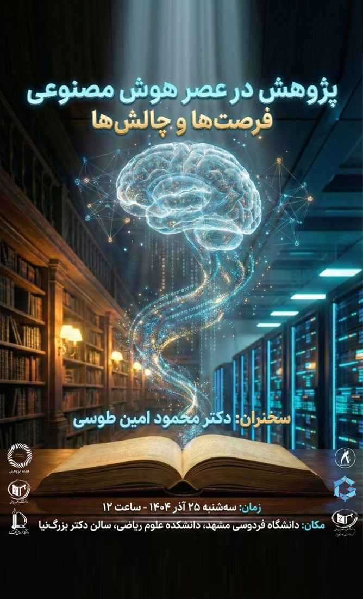 -->
<!-- 

## سرفصل‌های ارائه

1. نشست ۱: هوش مصنوعی مولد، عامل‌ها (Agent)، پرامپت و آموزش
2. نشست ۲: ابزارهای پژوهش، مرور ادبیات و مطالعه موردی
3. اخلاق، سیاست نشر و راستی‌آزمایی
4. پیوست: فرصت‌ها در علوم کامپیوتر

--- -->

<!-- _footer: ...   نشست ۱  -  مبانی و آموزش       -->

---

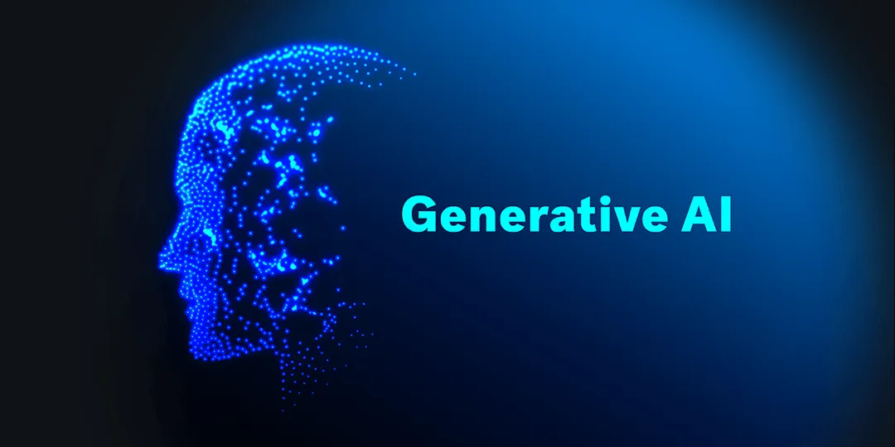

## بخش اول

## هوش مصنوعی مولد: انقلاب در پژوهش

---

| گذشته:            | امروز:                  |
| :---------------- | :---------------------- |
| جستجو در Google   | دستیارهای هوشمند پژوهشی |
| مطالعه صدها مقاله | خلاصه‌سازی خودکار       |
| نگارش دستی        | کمک در نگارش و ویرایش   |
| کدنویسی از صفر    | تولید کد با AI          |

---

<!-- html -->

  

    <video 
      controls 
      style="
        width: 100%;
        height: 70vh; 
        border-radius: 12px;
        box-shadow: 0 6px 20px rgba(0,0,0,0.25);
        background: #000; 
        object-fit: contain; 
      ">
      <source src="img/Research-Accelerator.mp4" type="video/mp4">
      مرورگر شما از تگ ویدئو پشتیبانی نمی‌کند.
    </video>
  

---

## جستجو در موتورهای جستجو و سامانه‌های جدید هوشمند

#### جستجوی عبارت:

### "لیست اعضای هیات علمی گروه علوم کامپیوتر دانشگاه فردوسی مشهد"

---

<!-- _class: invert cap -->

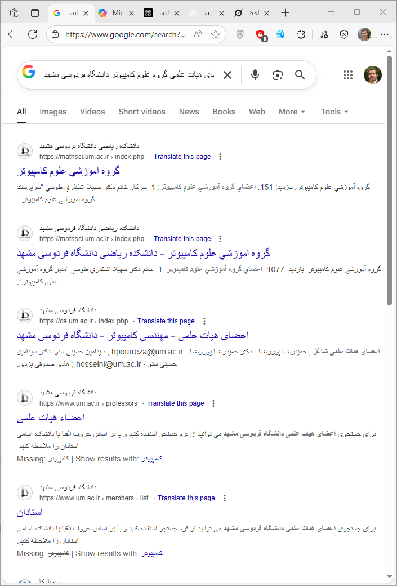
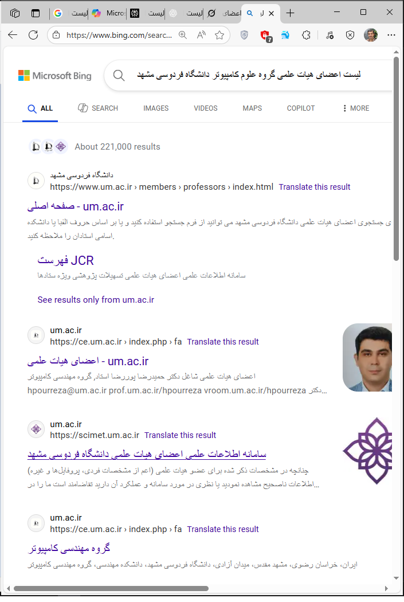

گوگل آدرس درست داد، اما بینگ نه.

---

<!-- _class: invert cap -->

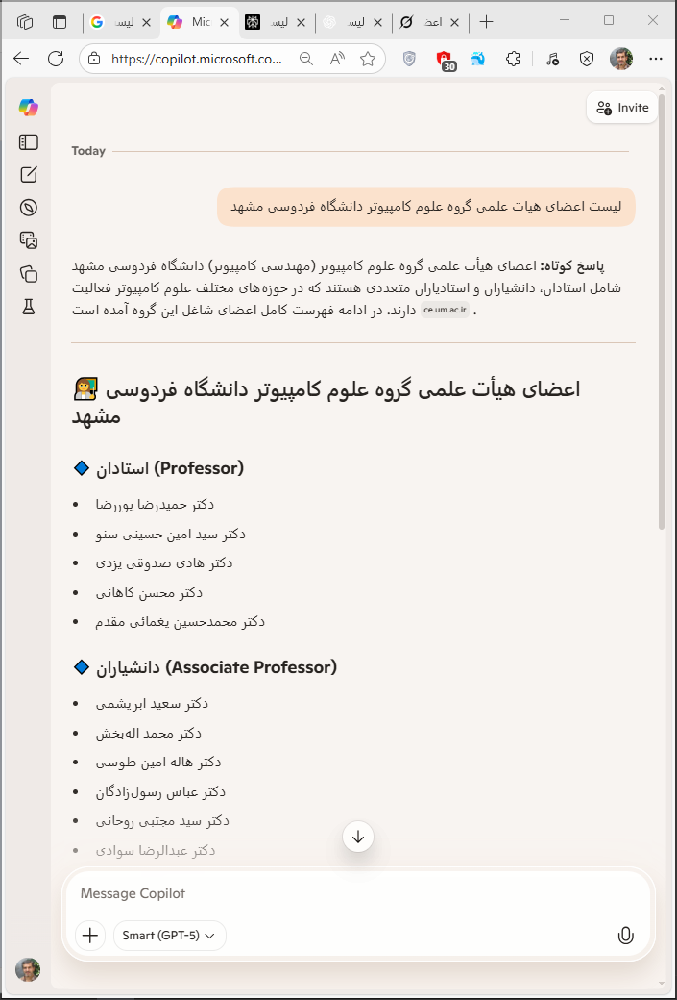
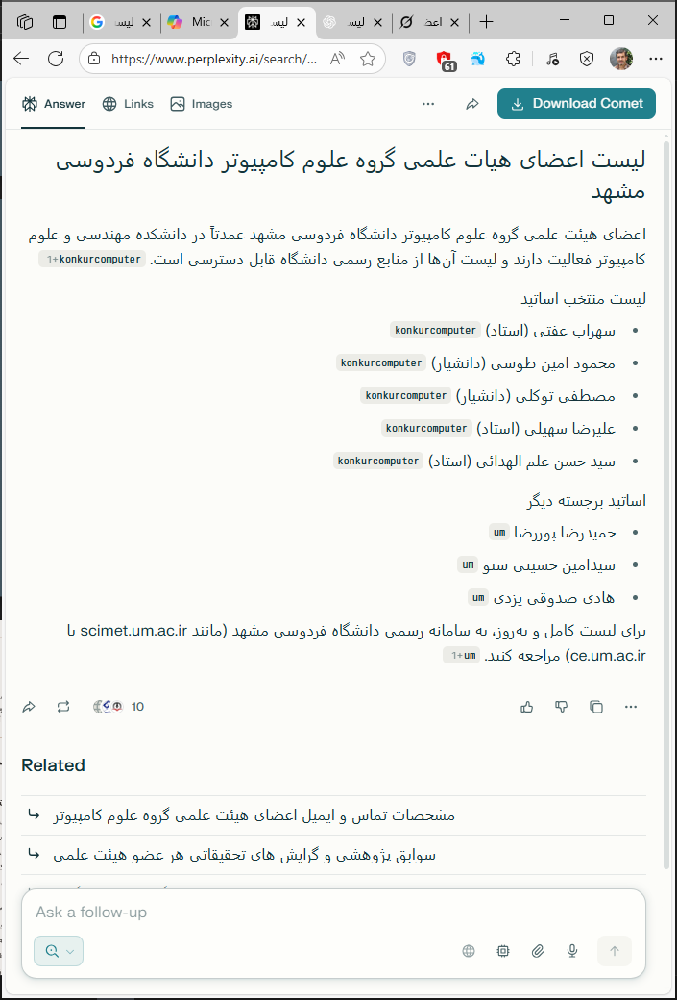

لیست دادند، اما درست نبود!

---

<!-- _class: invert cap -->

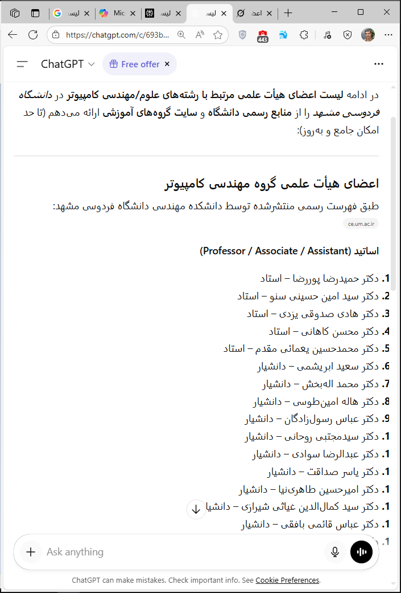
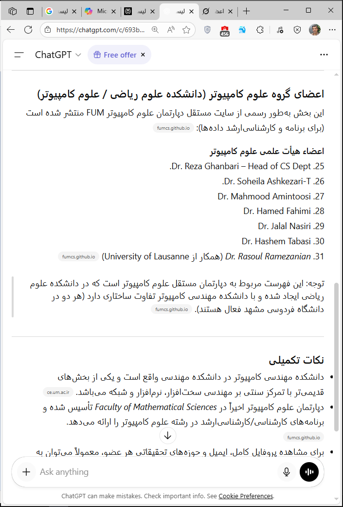

اول لیست اعضای گروه مهندسی کامپیوتر را داد و در ادامه، لیست اعضای گروه علوم کامپیوتر را (بر اساس گیت هاب و نه صفحه اصلی).

---

<!-- _class: invert cap -->

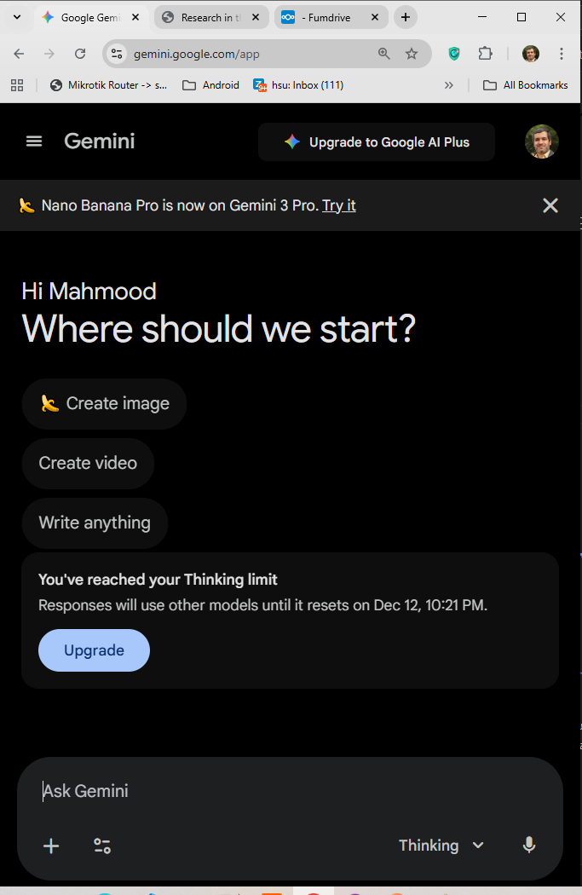
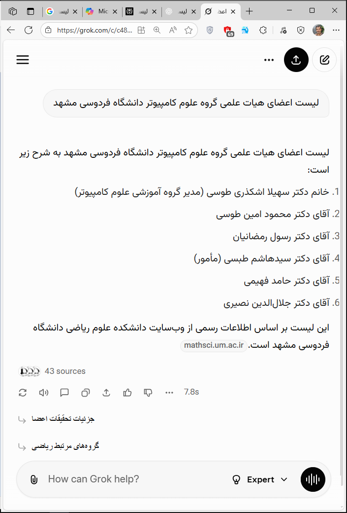

خروجی گروک دقیق بود.

<!-- ---

حتی نتایج گوگل هم ممکن است اشتباه باشد!

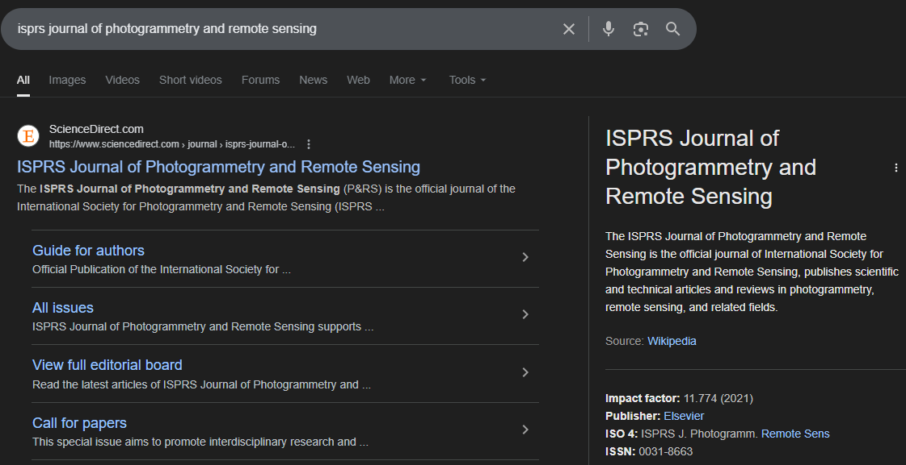

---

|                                              |                                                |
| :------------------------------------------: | :--------------------------------------------: |
| 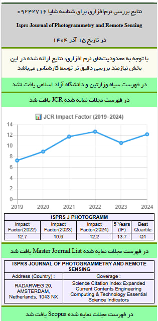 | 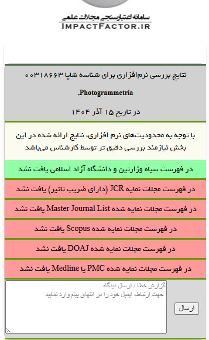 |
 -->

---

### هوش مصنوعی مولد چیست؟

- **تعریف:** مدل‌هایی که براساس الگوهای یادگرفته‌شده از داده‌ها، محتوای جدید «تولید» می‌کنند

- مانند یک نویسنده، نقاش، یا برنامه‌نویس

| نام مدل        | شرکت/توسعه‌دهنده | وب‌سایت                                                  |
| :------------- | :--------------- | :------------------------------------------------------- |
| **ChatGPT**    | OpenAI           | [chatgpt.com](https://chatgpt.com)                       |
| **Claude**     | Anthropic        | [anthropic.com/claude](https://www.anthropic.com/claude) |
| **Gemini**     | Google           | [gemini.google.com](https://gemini.google.com)           |
| **DeepSeek**   | DeepSeek (چین)   | [chat.deepseek.com](https://chat.deepseek.com)           |
| **Grok**       | xAI              | [grok.com](https://grok.com)                             |
| **GLM (Z.AI)** | Zhipu AI (چین)   | [z.ai](https://z.ai)                                     |

---

## مدل‌ها و بنچمارک‌ها (نوامبر ۲۰۲۶)
| دسته مدل | مدل‌های منتخب | مرجع بنچمارک |
| :--- | :--- | :--- |
| **مدل‌های زبانی** | GPT-6, Gemini 4 Pro, Claude Opus 5.5, Grok 4.7 | [LMArena](https://arena.ai), [Artificial Analysis](https://artificialanalysis.ai/) |
| **متن به تصویر** | Nano Banana Pro, FLUX 2, Imagen 4 | [Artificial Analysis](https://artificialanalysis.ai/models/text-to-image) |
| **توصیف تصویر** | Florence-2, Qwen2-VL | [OpenVLM Leaderboard](https://huggingface.co/spaces/opencompass/open_vlm_leaderboard) |
| **متن به ویدئو** | Runway Gen-3, Kling AI | [Video Gen Leaderboard](https://huggingface.co/spaces/ArtificialAnalysis/Video-Generation-Leaderboard) |
| **مدل‌های چندوجهی** | GPT-6, Gemini 4 | [MMMU Benchmark](https://mmmu-benchmark.github.io/) |
| **بینایی-زبانی** | InternVL2, Qwen2-VL | [OpenCompass](https://huggingface.co/spaces/opencompass/open_vlm_leaderboard) |
| **تخصصی (ریاضی/کد)** | Claude Opus 5.5, DeepSeek V4.1 | [Epoch AI](https://epoch.ai/frontiermath), [LiveCodeBench](https://livecodebench.github.io/leaderboard.html) |

> نام مدل‌ها سریع عوض می‌شود؛ معیار انتخاب، تطابق با وظیفه و دسترسی است.

<!-- ---

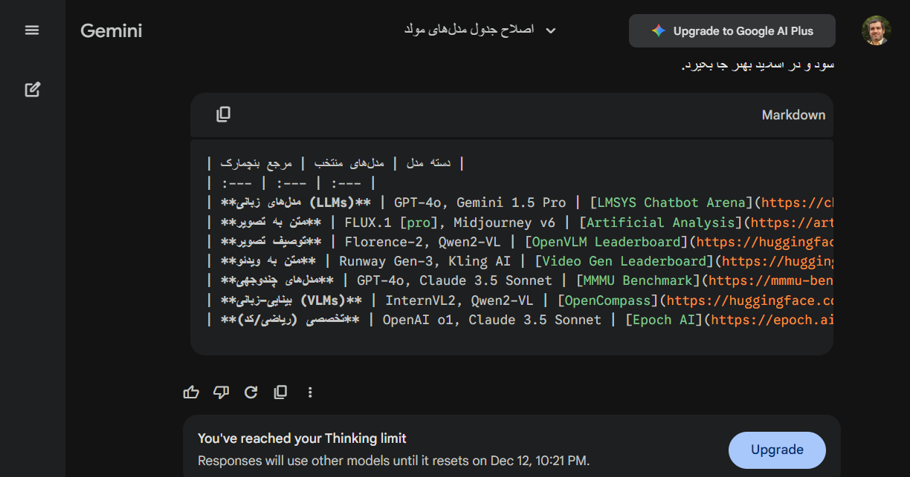 -->

---

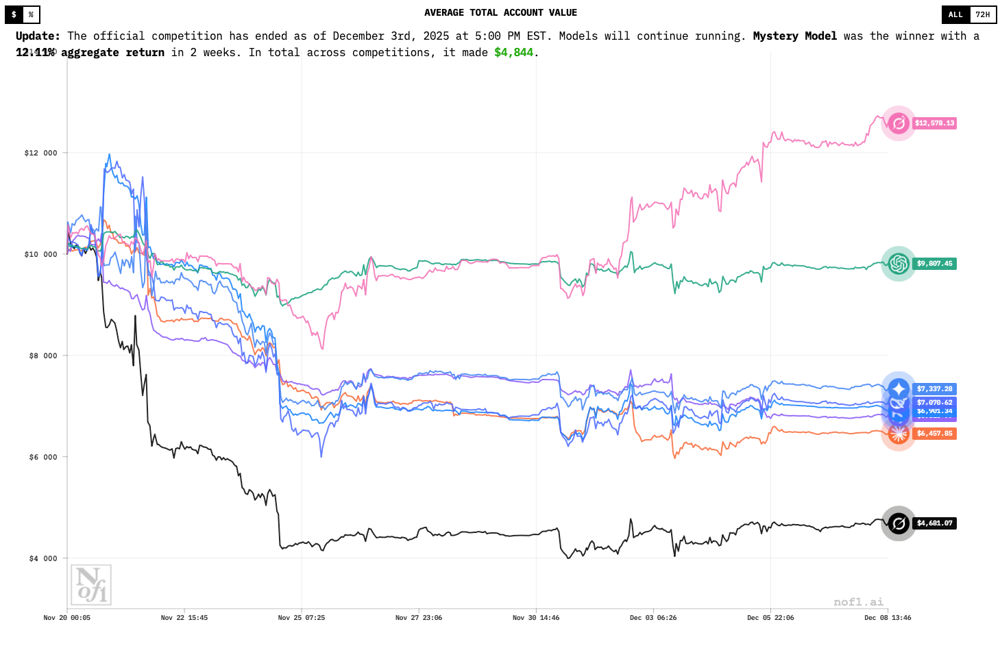

######[AI model Grok 4.2 wins Alpha Arena trading tournament](https://forklog.com/en/ai-model-grok-4-2-triumphs-in-trading-tournament/)

<!-- *تصویر آرشیوی ۲۰۲۵ — وضعیت روز را در [llm-stats](https://llm-stats.com/) ببینید* -->

---

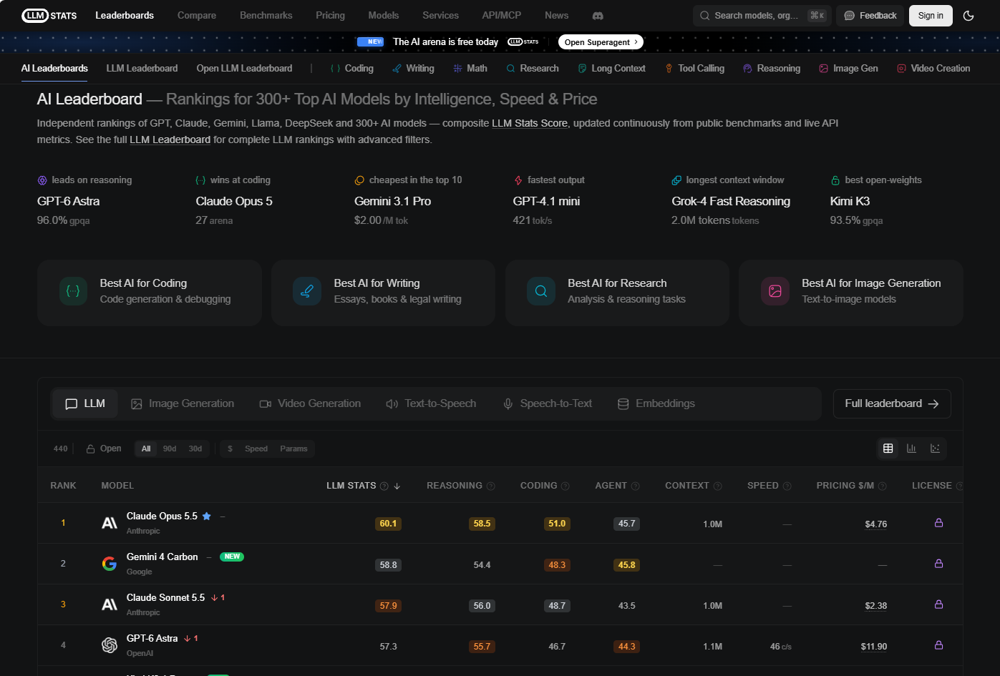

### [llm-stats.com: AI Leaderboards](https://llm-stats.com/)

---

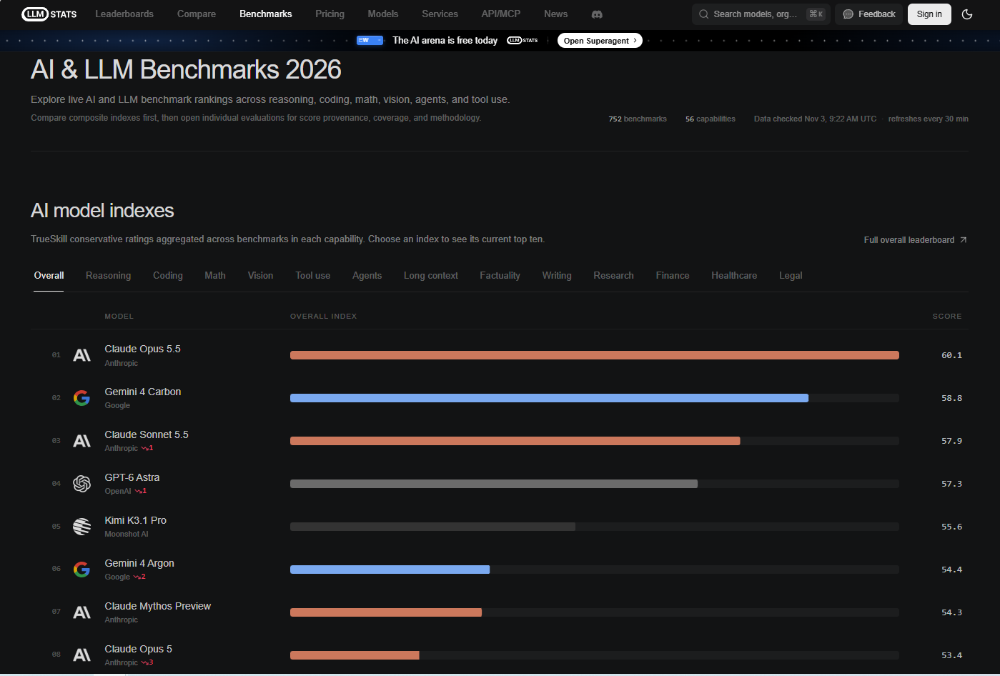
### [llm-stats.com: Benchmarks](https://llm-stats.com/benchmarks)

---

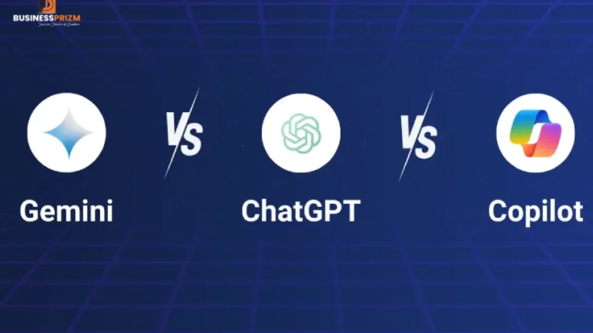

### مدل‌های «تولید متن از متن» (Text → Text)

| نمونه                                              | کاربرد اصلی                   | مالک      |
| -------------------------------------------------- | ----------------------------- | --------- |
| [ChatGPT](https://chatgpt.com)                     | گفتگو، کدنویسی، نگارش علمی    | OpenAI    |
| [Claude](https://claude.ai)                        | تحلیل عمیق، استدلال متنی      | Anthropic |
| [Gemini](https://gemini.google.com)                | چندوجهی، جستجوی هوشمند        | Google    |
| [DeepSeek](https://chat.deepseek.com)              | استدلال و کدنویسی             | DeepSeek  |
| [Microsoft Copilot](https://copilot.microsoft.com) | دستیار برنامه‌نویسی و آفیس    | Microsoft |
| [Grok](https://grok.com)                           | گفتگو با دسترسی به داده‌های X | xAI       |
| [GLM (Z.AI)](https://z.ai)                         | کدنویسی و وظایف تخصصی         | Zhipu AI  |

> این گروه، ستون فقرات ابزارهای پژوهشی مبتنی بر LLM محسوب می‌شود.

---

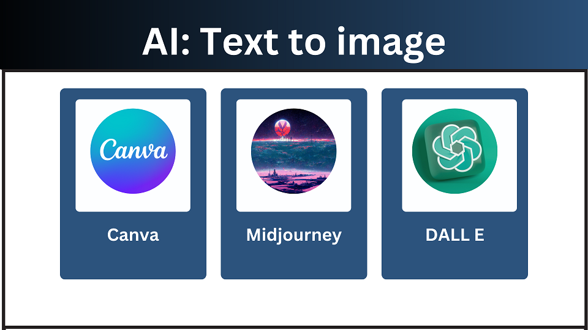

## تولید تصویر از متن — (Text → Image)

| ابزار                                         | کاربرد / ویژگی                           |
| --------------------------------------------- | ---------------------------------------- |
| [Imagine.art](https://www.imagine.art)        | تولید تصویر فوری، رایگان، مدل‌های تعاملی |
| [Text to Image](https://www.texttoimage.org/) | رایگان                                   |
| [Canva AI](https://www.canva.com)             | تولید سریع تصویر + ابزار طراحی           |
| [Leonardo AI](https://www.leonardo.ai)        | تصویرسازی هنری / مفهومی                  |
| [Dream by Wombo](https://dream.ai/)           | تولید تصویر با سبک‌های هنری              |

<!-- ---

یک متن فارسی در مورد ترکیبی از خصوصیات سه تن از اساتید را به کوپایلوت دادم و پرامپت مناسب به زبان انگلیسی خواستم که این شد:

###### A cheerful middle-aged professor (around 45 years old) with short beard and salt-and-pepper hair, smiling warmly in his office at Ferdowsi University of Mashhad. His office is decorated with Tintin posters, figurines, and memorabilia, along with many flowers and green plants. A large glass blackboard, gifted by his students, is mounted on the wall, covered with colorful mathematical formulas written in marker. Several students are gathered around him, engaged in lively discussion, showing their admiration for his love of teaching. The office also contains a sofa, desk, chairs, computer, and coffee, creating a cozy and intellectual atmosphere full of energy and inspiration. -->

---

## خروجی کوپایلوت با GPT-5

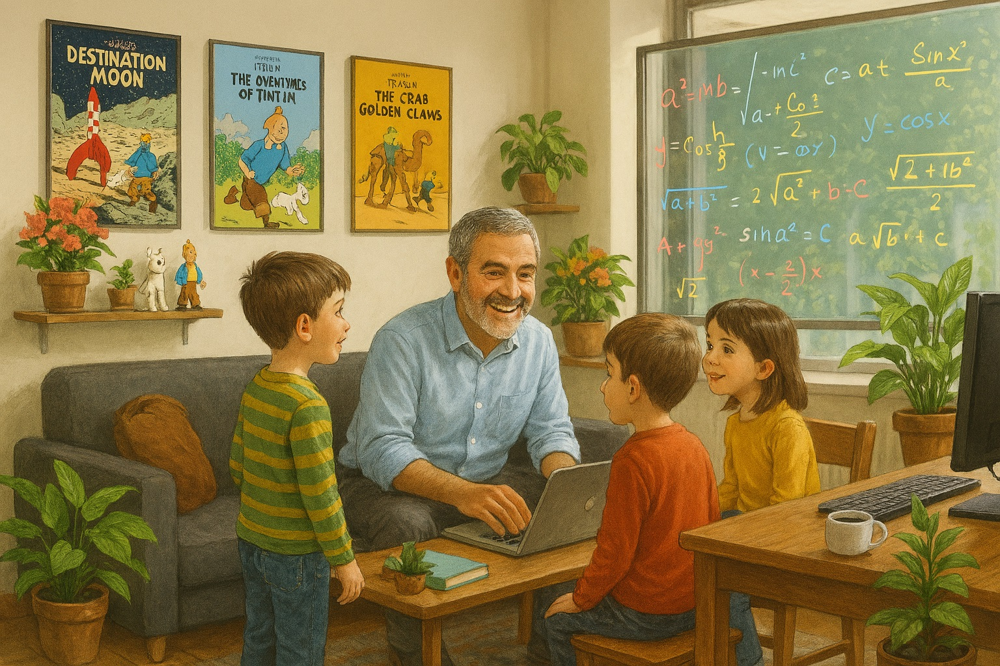

---

## خروجی imagine.art با Nano-Banana-Pro

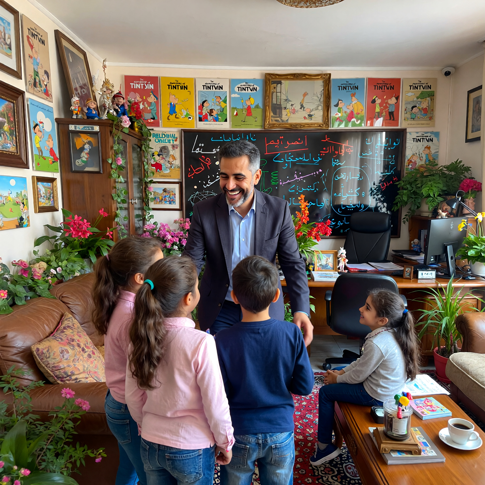

---

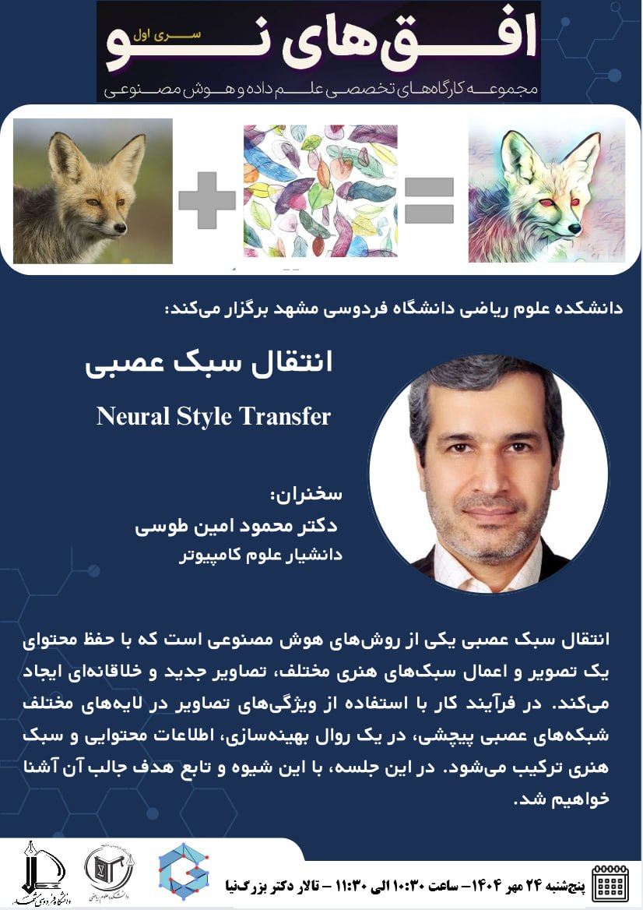

 <!-- مقایسه دو ابزار رایگان تولید تصویر با AI -->

- GPT-5 vs Nano Banana Pro
- تفاوت در واقع‌گرایی، وضوح، سبک هنری
- مناسب برای کدام کاربرد؟ (پوستر، ارائه، مقاله، تصویرسازی مفهومی)
- برای اطلاعات بیشتر در مورد شیوه تقلید یک اثر هنری در نقاشی ارائه‌ی قبلی با عنوان [انتقال سبک عصبی](https://1drv.ms/p/c/31166a0f5c94f268/EWjylFwPahYggDGCUwAAAAAB8JI2ARAES9QukZKKiM_EHw?e=qsdToe) را ملاحظه فرمایید

---

<!-- 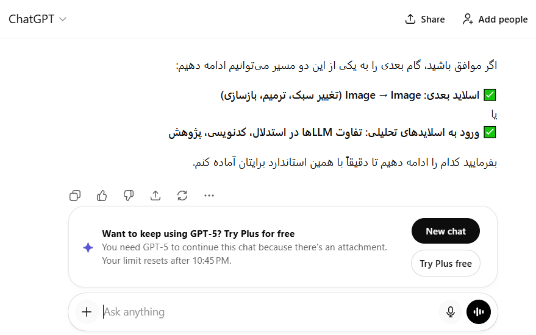

--- -->

## تبدیل تصویر به تصویر (Image → Image)

| ابزار                                                          | کاربرد / ویژگی                            |
| -------------------------------------------------------------- | ----------------------------------------- |
| [Fotor AI](https://www.fotor.com/features/ai-image-generator/) | روتوش، حذف اشیاء، تبدیل سبک عکس           |
| [Photopea](https://www.photopea.com)                           | ویرایشگر آنلاین رایگان با فیلترهای هوشمند |
| [Canva AI](https://www.canva.com)                              | تغییر خودکار سبک، پس‌زمینه، رنگ‌ها        |
| [Pixlr AI](https://pixlr.com)                                  | اصلاح و انتقال سبک                        |

<!-- > این ابزارها برای ترمیم، تغییر سبک و بهبود کیفیت تصاویر موجود مناسب‌اند. -->

---

## تولید ویدئو از متن (Text → Video)

| ابزار                                                        | کاربرد / ویژگی                                     |
| ------------------------------------------------------------ | -------------------------------------------------- |
| [MovieFlow](https://movieflow.ai/signup?inviteCode=ZCKDT14H) | تولید ویدئوهای کوتاه با استایل سینمایی، پلن رایگان |
| [Hailuo AI Video](https://hailuoai.video/)                   | تولید سریع ویدئو از متن، نسخه رایگان دارد          |
| [Luma AI (Dream Machine)](https://lumalabs.ai/dream-machine) | حرکت طبیعی دوربین و اجسام، نسخه رایگان محدود       |
| [Runway Gen-4](https://runwayml.com) | تولید ویدئو از متن/عکس، نسخه رایگان محدود |
| [Pika](https://www.pika.art)                                 | ویدئوهای کوتاه خلاقانه، پلن رایگان                 |
| [Kapwing AI Video](https://www.kapwing.com/ai)               | ساخت کلیپ از متن، ابزارهای ویرایش رایگان           |

> عمر ابزارها کوتاه است — نمونه: Sora که پارسال در همین جدول‌ها بود، در ۲۰۲۶ تعطیل شد.

---

## مدل‌های چندوجهی — Multimodal AI Models

### ورودی/خروجی: متن، تصویر، صوت، ویدئو

| مدل                                                      | توانایی / ویژگی کلیدی                        |
| -------------------------------------------------------- | -------------------------------------------- |
| [GPT](https://chatgpt.com)                               | متن + تصویر + صوت؛ مکالمه چندحالته           |
| [Gemini](https://gemini.google.com)                      | پردازش متن، تصویر، صوت و ویدئو در مقیاس بزرگ |
| [Claude](https://claude.ai)                              | تحلیل متن و تصویر با دقت بالا                |
| [Ollama Models](https://ollama.com/library)              | اجرای مدل‌های متن‌باز (LLM / VLM) روی لپ‌تاپ |
| [HuggingFace Multimodal](https://huggingface.co/unsloth) | مجموعه‌ای از مدل‌های رایگان متن-باز          |

مقاله با عنوان [The Llama 3 Herd of Models](https://arxiv.org/abs/2407.21783) حدود پانصد نویسنده دارد!

<!-- > مدل‌های چندوجهی مسیر حرکت به سوی [هوش جامع مصنوعی](https://fa.wikipedia.org/wiki/%D9%87%D9%88%D8%B4_%D8%AC%D8%A7%D9%85%D8%B9_%D9%85%D8%B5%D9%86%D9%88%D8%B9%DB%8C) (AGI-like) را نشان می‌دهند. -->

---

<!-- html -->

  
  

  <h3>
    <a href="https://grok.com/share/c2hhcmQtMg_729a6609-5444-47b6-8619-9c8db0d3b5a3">سناریوی</a> این ویدئو را یک مدل زبانی نوشت
    </h3>
    

  

    <video 
      autoplay 
      loop 
      muted 
      controls
      style="
        width: 100%;
        height: 60vh;
        border-radius: 10px;
        box-shadow: 0 5px 15px rgba(0,0,0,0.2);
      ">
      <source src="img/one-year.mp4" type="video/mp4">
    </video>
  

---

## بخش دوم

## عامل‌های هوش مصنوعی: از پاسخ‌گویی تا اجرا

---

## سه گونه ابزار هوش مصنوعی: از پاسخ تا اجرا

- **دستیار گفتگویی** — پاسخ را از حافظه‌ی مدل می‌سازد؛ برای ایده، پیش‌نویس متن و کد کوتاه.
  - نمونه: ChatGPT، Gemini، DeepSeek
  - محدودیت: منبع قابل ردیابی ندارد ← خطر توهم و منبع جعلی

- **دستیار مبتنی بر منبع** — ابتدا در پایگاه واقعی جستجو می‌کند، سپس با LLM تحلیل می‌کند.
  - نمونه: SciNiTO، Elicit، NotebookLM
  - مزیت: منبع قابل کلیک و راستی‌آزمایی؛ تفسیر همچنان با شماست

- **عامل (Agent)** — فایل می‌خواند، کد می‌نویسد، اجرا می‌کند، خطا را می‌بیند و خود را اصلاح می‌کند.
  - نمونه: Cursor، Claude Code، Copilot، Freebuff
  - تفاوت بنیادی: مجاز است در محیط شما تغییر ایجاد کند ← ریسک اصلی

> **نکته:** لایه‌ی ۱ و ۲ «ایده می‌دهند»، لایه‌ی ۳ «کار انجام می‌دهد» — و همان‌جا مسئولیت درستی خروجی بر عهده‌ی شماست. این سه، مرز **نقش و اعتماد** را روشن می‌کنند، نه مرز فنی سخت.

---

## عامل‌های هوش مصنوعی (Agent) چیستند؟

| ویژگی                | توضیح                                                                                                                                                                             |
| -------------------- | --------------------------------------------------------------------------------------------------------------------------------------------------------------------------------- |
| **عامل هوشمند**            | سیستمی که یک مدل زبانی را با **ابزار**، **حافظه** و یک **حلقه اجرا** ترکیب می‌کند تا یک هدف چندمرحله‌ای را تا پایان پیش ببرد                                                            |
| **تفاوت با چت‌بات** | فقط پاسخ نمی‌دهد؛ فایل می‌خواند، کد اجرا می‌کند، نتیجه را می‌بیند و مسیرش را اصلاح می‌کند                                                                                             |
| **تفاوت با جستجوگر منبع‌دار** | جستجوگر منبع‌دار فقط می‌خواند و پاسخ می‌دهد؛ عامل مجاز است در محیط شما تغییر ایجاد کند (ریسک اصلی)  |
| **کاربردها**         | بازتولید نتایج یک مقاله از مخزن کد، توسعه نرم‌افزار، مرور ادبیات، ساخت آزمون، خودکارسازی کارهای تکراری                                                                                      |

---

## عامل در عمل: یک حلقه، نه یک پاسخ

| گام          | کاری که عامل انجام می‌دهد                | نمونه در کار پژوهش              |
| ------------ | ---------------------------------------- | ------------------------------- |
| **۱. هدف**   | وظیفه و معیار موفقیت را می‌گیرد            | اجرای مخزن و بازتولید نتایج      |
| **۲. برنامه**| کار را به گام‌های کوچک می‌شکند            | خواندن README، نصب وابستگی، اجرا |
| **۳. اقدام** | ابزار را صدا می‌زند: فایل، ترمینال، جستجو | اجرای کد، جست‌وجوی DOI، ویرایش   |
| **۴. مشاهده**| خروجی ابزار را می‌خواند (خطا، عدد، متن) | دیدن خطای اجرا یا جدول نتایج    |
| **۵. اصلاح** | مسیر را عوض می‌کند و ادامه می‌دهد         | رفع خطا، تغییر پارامتر، اجرا    |

<!-- ### نکته کلیدی -->

> کیفیت کار عامل به «معیار موفقیت» و «ابزار در اختیار» بستگی دارد، نه فقط به هوشمندی مدل.

---

## از تکمیل خودکار تا عامل خودگردان

| سطح                     | اختیار                                  | نمونه امروز                          | ریسک اصلی                |
| ----------------------- | ---------------------------------------- | ------------------------------------- | ------------------------ |
| **۱. تکمیل کد یا متن**  | پیشنهاد می‌دهد، شما می‌پذیرید            | Copilot autocomplete                  | خطای کوچک، قابل تشخیص    |
| **۲. گفتگو با اسناد**   | می‌خواند و پاسخ می‌دهد                    | NotebookLM، ChatGPT Projects          | توهم در تفسیر سند         |
| **۳. عامل با ابزار**    | فایل و ترمینال را تغییر می‌دهد           | Freebuff، Cursor، Claude Code، Codex  | تغییر ناخواسته            |
| **۴. چند عامل موازی**   | کار را تقسیم و جمع‌بندی می‌کند            | orchestration / subagents             | خطا در هماهنگی            |
| **۵. خودگردان طولانی** |ساعت‌ها بدون نظارت، با تصمیم‌های برگشت‌ناپذیر | در محیط ایزوله با snapshot کارآمد؛ در محیط باز، نیازمند نظارت نقطه‌ای   | انحراف از هدف، هزینه، حالت غیرقابل بازگشت     |

<!-- > هر پله بالاتر: توان بیشتر، و **نیاز به مهار بیشتر**. برای پژوهش، سطح ۳ با نظارت بیشترین بازده را دارد. -->

<!--
سطح چهار:
 «۲۰۰۰ مقاله را بین ۱۰ عامل تقسیم می‌کنیم؛ هر کدام فقط شامل/حذف می‌گوید؛ نتیجه را با union جمع می‌کنیم. این کار بی‌مشکل است، چون هیچ عاملی به داده یا تصمیم دیگری دست نمی‌زند. اما اگر قرار باشد این ۱۰ عامل در نهایت با هم به یک جمع‌بندی واحد برسند، دیگر موازی نیست — یک گام قضاوتی ترتیبی لازم است، و همان‌جا خطاها شروع می‌شوند.» -->

<!-- سطح پنج:
سطح ۵ یعنی کاری که ساعت‌ها بدون نظارت پیش می‌رود و در میانه، تصمیم‌های برگشت‌ناپذیر می‌گیرد. مثال: استقرار JupyterHub روی WSL با Docker. این وظیفه ۲۰ گام وابسته دارد، در گام ۳ انتخابی می‌کند که در گام ۱۸ معلوم می‌شود غلط بوده، و برای اعمال بعضی تغییرها باید WSL یا Docker را ری‌استارت کند — که همان‌جا خودش را از دست می‌دهد. پس سطح ۵ نه به این دلیل که مدل کم‌هوش است، بلکه چون محیط شکننده است، هنوز آماده‌ی سپردن نیست. کاری که می‌شود کرد: عامل پیش‌نویس اسکریپت و config را بسازد، شما در نقاط حساس تأیید کنید — این سطح ۳ است، و برای این وظیفه کافی است.» -->

---

## نمونه‌ها: سه جور جای زندگی

**داخل ادیتور (کنار کد شما):**
- [Cursor](https://cursor.com) — عامل داخل VS Code، با درک کل پروژه
- [Copilot](https://github.com/features/copilot) — عامل داخل ادیتور، یکپارچه با GitHub
- [Claude Code](https://claude.com/product/claude-code) — هم در ادیتور، هم در ترمینال

**در ترمینال (بدون رابط گرافیکی):**
- [OpenAI Codex](https://openai.com/codex) — عامل خط فرمان
- [Gemini CLI](https://github.com/google-gemini/gemini-cli) — عامل خط فرمان

**مستقل (اپ یا مرورگر):**
- [Freebuff](https://freebuff.com) — عاملی که همین ارائه را ویرایش کرده است

<!-- > **تفاوت ساده:** عامل درون ادیتور «کنار شما» کار می‌کند و هر تغییر را می‌بینید؛ عامل ترمینال «به‌جای شما» کار می‌کند و فقط نتیجه را می‌بینید. برای کار طولانی و خودکار، ترمینال؛ برای کار حساس و تعاملی، ادیتور. -->

---

## مثال اول از FreeBuff

### حذف فایل‌های اضافی سیستم

<figure style="width: 46%;">
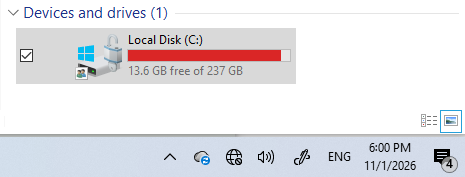
<figcaption>قبل — ۱۳٫۶ گیگابایت آزاد از ۲۳۷</figcaption>
</figure>

<figure style="width: 46%;">
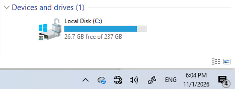
<figcaption>بعد — ۲۶٫۷ گیگابایت آزاد، بدون حذف داده‌ی لازم</figcaption>
</figure>

> صورت مسئله یکی بود: «چه چیزی را می‌توانم حذف کنم؟» — عامل اول اندازه گرفت، بعد پیشنهاد داد.

---
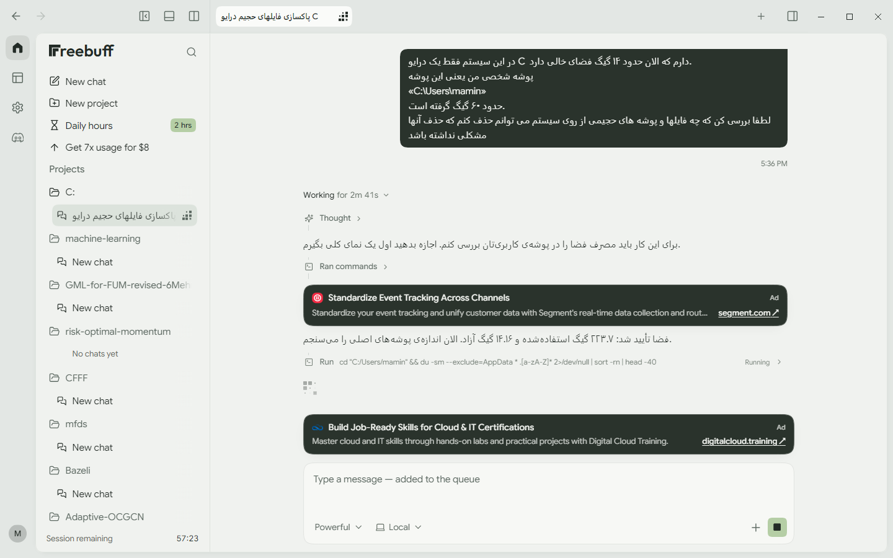

---

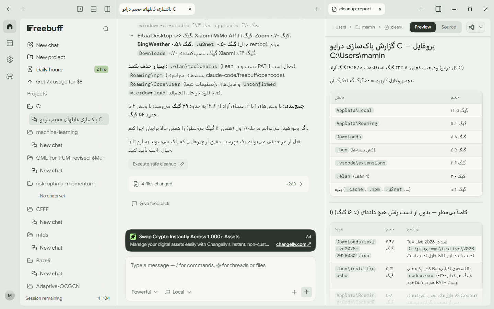

---

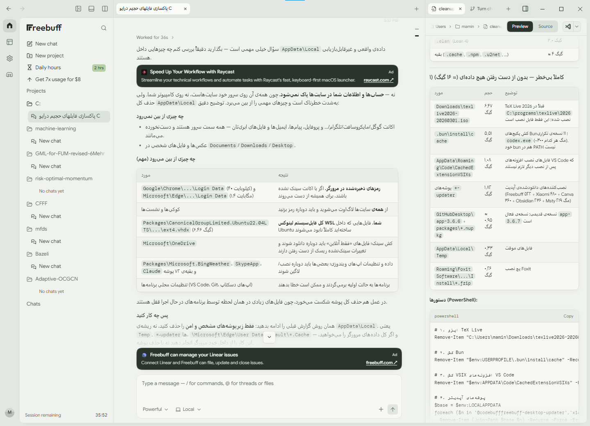

---

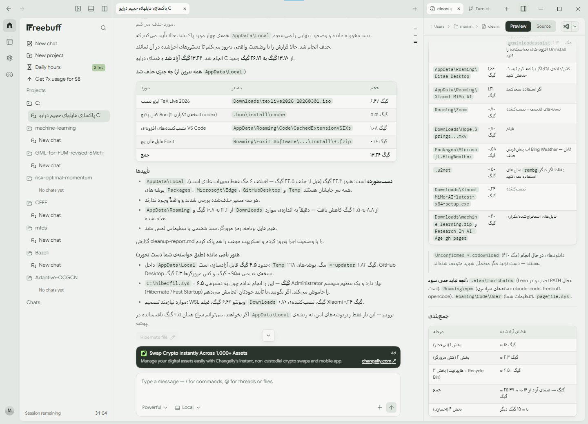

---

#### نکته: همین چند اسلاید قبل و بعد هم با FreeBuff  روبراه شده‌اند.

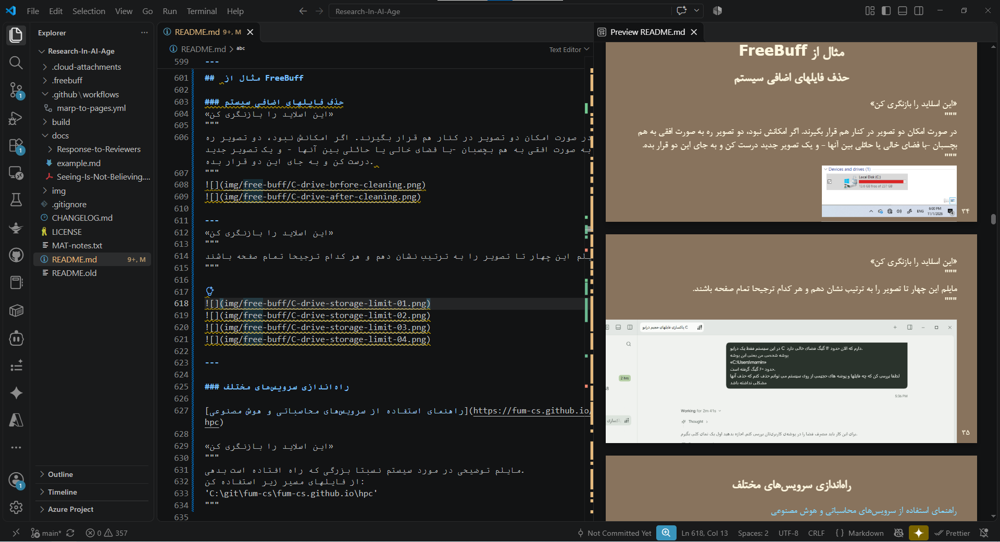

---

## مثال دوم از FreeBuff

### پشت صحنه: یک ماشین، یک کارت گرافیک، چند سرویس 

| فناوری | نقش در راه‌اندازی |
| --- | --- |
| **WSL + Ubuntu** | لایه‌ی لینوکسی روی ویندوز؛ ابزارها و اسکریپت‌ها اینجا اجرا می‌شوند |
| **Docker Desktop** | هر سرویس در یک کانتینر مستقل، با دسترسی به GPU  |
| **Ollama** (نسخه ویندوز) | اجرای مدل‌های زبانی محلی، مثل qwen3، روی کارت گرافیک |
| **LDAP Proxy**  |برای استفاده از حساب کاربری دانشگاهی  |
| **PowerShell و bash** | شروع خودکار سرویس‌ها پس از ری‌استارت، و پشتیبان‌گیری از تصاویر  |

> سرویس‌ها: JupyterHub، code-server (Lean)، Open WebUI، API مدل‌ها و چند ابزار دیگر؛ 

<!-- ---

## از بیرون دانشکده هم در دسترس است

- **داخل دانشکده:** آدرس داخلی سرور در مرورگر، ورود با حساب ویندوز دانشگاهی
- **بیرون دانشکده:** شبکه‌ی خصوصی Tailscale — بی‌نیاز از باز کردن پورت روی اینترنت
- **راه‌اندازی:** یک اسکریپت PowerShell همه‌ی سرویس‌ها را بالا می‌آورد
- **پشتیبان:** اسکریپت tar از تصاویر و نسخه‌ی `.bak` از پیکربندی‌ها
- **مستندسازی:** دو صفحه‌ی وب — یکی برای کاربر، یکی برای نصب و نگهداری

> الگوی قابل تکرار: سرویس‌ها در Docker جدا، داده روی درایو دیگر، و هر تغییر مستند. سیستم با کمک عامل ساخته شد، اما هر گام با آزمون انسانی. -->

---

## عامل در کار استاد: چه بسپاریم، چه نه

| قابل سپردن — با بازبینی                      | بهتر است نسپاریم — یا با کنترل شدید      |
| -------------------------------------------- | ---------------------------------------- |
| بازتولید نتایج مقاله از مخزن کد               | داوری علمی نهایی و حکم درباره نوآوری      |
| پاک‌سازی داده، ساخت جدول و شکل                | تصمیم درباره نویسندگی و انتساب            |
| نسخه اول آزمون و اسلاید                | پاسخ به داوران بدون بازخوانی              |
| جستجو و پالایش منابع (با راستی‌آزمایی DOI)     | داده شخصی، بیمار یا محرمانه              |
| بازآرایی کد آموزشی و افزودن تست                | ارزیابی نهایی دانشجو و بازخورد حساس      |

> قاعده: **وظیفه را می‌سپاریم، مسئولیت را نه.** هر خروجی که با نام شما منتشر می‌شود، کار شماست.

---

## عامل‌ها: خطرها، مهارها و چک‌لیست

| خطر                | چطور رخ می‌دهد                                          | مهار                                              |
| ------------------ | ------------------------------------------------------- | ------------------------------------------------- |
| **تزریق پرامپت**    | دستور مخفی در یک فایل، صفحه وب یا PDF که عامل اجرا می‌کند | محیط ایزوله، بدون دسترسی به رمز و حساب کاربری     |
| **بیش‌مجوزی**       | عامل فایلی را پاک یا بازنویسی می‌کند                      | Git، شاخه جدا، تأیید انسانی برای تغییرات           |
| **شکست خاموش**      | اجرا موفق است، اما نتیجه غلط است                         | تست، مقایسه با خط پایه، اجرای دوباره               |
| **هزینه و زمان**    | حلقه‌های طولانی و اجرای مکرر                             | محدوده مشخص، معیار پایان، سقف هزینه                |
| **محرمانگی**        | ارسال داده به سرویس بیرونی                              | سیاست داده، نسخه محلی، حذف شناسه‌ها                |

---

### پیش از سپردن کار به عامل، پنج پرسش

- هدف و معیار موفقیت روشن است؟ به کدام فایل‌ها و حساب‌ها دسترسی دارد؟
- نسخه پشتیبان یا Git دارم؟ کجا باید از من تأیید بگیرد؟
- خروجی را چطور راستی‌آزمایی می‌کنم؟

### مرز مسئولیت

> **عامل‌ها قدرتمندند، اما خودمختارِ قابل‌اعتماد نیستند؛  
> هر تغییری که در محیط شما می‌کنند باید قابل بازگشت و قابل بازبینی باشد.**

---

<!-- html -->

  
  

    <h2>بخش سوم</h2>
    <h3>
      مهندسی پرامپت: کلید استفاده موثر از مدل‌های هوش مصنوعی
    </h3>
    

  

    <video 
      autoplay 
      loop 
      muted 
      controls
      style="
        width: 100%;
        height: 60vh;
        border-radius: 10px;
        box-shadow: 0 5px 15px rgba(0,0,0,0.2);
      ">
      <source src="img/From-Traditional-Research-to AI-Powered-Acceleration.mp4" type="video/mp4">
    </video>
  

---

## چرا پرامپت‌نویسی مهم است؟

### 🎯 پرامپت = دستورالعمل شما برای AI

- **دقت خروجی:** پرامپت خوب = پاسخ دقیق و مفید
- **کنترل نتیجه:** شما «مهندس» گفتگو هستید
- **بهینه‌سازی:** پرامپت ضعیف = پاسخ بی‌ربط

### [اسلایدهای آماده‌شده با کمک جمینای](https://docs.google.com/presentation/d/1IZw3Rj7w47ZrtogpjayEacRhTEoO1YqWHGNgzWMRnjc/edit?usp=sharing)

---

### چارچوب پرامپت حرفه‌ای

| مؤلفه               | توضیح مختصر             | نمونه                                            |
| ------------------- | ----------------------- | ------------------------------------------------ |
| **Persona (شخصیت)** | تعیین نقش یا تخصص AI    | «تو یک محقق یادگیری ماشین هستی.»                 |
| **Context (زمینه)** | ارائه اطلاعات پیش‌زمینه | «در حال نوشتن بخش کارهای مرتبط درباره CNN هستم.» |
| **Task (وظیفه)**    | مشخص‌کردن کار اصلی      | «۱۰ مقاله کلیدی را فهرست کن.»                    |
| **Format (قالب)**   | شکل خروجی               | «نتیجه را در قالب جدول LaTeX بده.»               |
| **Tone (لحن)**      | سبک و لحن متن           | «لحن رسمی، علمی و دقیق باشد.»                    |
| **Exemplar(نمونه)** | نمونه ورودی/خروجی       | «چند مثال برای تقلید ارائه می‌دهم.»              |

> ساختاردهی صحیح پرامپت کیفیت خروجی مدل‌های زبانی را چند برابر افزایش می‌دهد.

<!-- ###### Professional Prompt Engineering (P–C–T–F–T–E) -->

---

## نکات کلیدی مهندسی پرامپت

| موضوع                             | نکته کاربردی (خلاصه)                                                               |
| --------------------------------- | ---------------------------------------------------------------------------------- |
| **مرحله‌به‌مرحله** | خروجی را گام به گام بخواهید                                                        |
| **جداکننده‌ها**      | برای مشخص‌کردن متن هدف از جداکننده سه‌گانه استفاده کنید:  `"""متن شما اینجا"""` |
| **نمونه‌های آموزشی**   | چند مثال مطلوب نشان بدهید تا قالب موردنظر را یاد بگیرد. (۲–۳ مثال کافی است)        |
| **توسعه تکراری**        | پرامپت را اجرا کن ← خروجی را آنالیز کن ← پرامپت را اصلاح کن ← مجدداً اجرا کن.      |

---

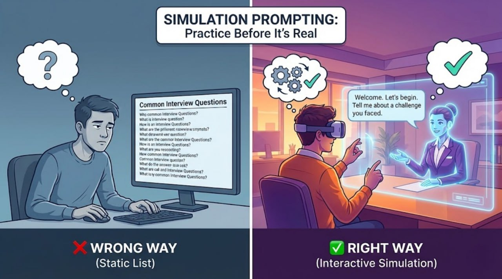

⭐ تکنیک شبیه‌سازی: (برگرفته از [کانال هوش‌مصنوعی در پژوهش،](http://t.me/ai_in_research))

چرا فقط درباره «مصاحبه کاری» یا «دفاع پایان‌نامه» سوال می‌پرسی وقتی می‌تونی واقعاً تجربه‌ش کنی؟ 😎

🔵 تکنیک «شبیه‌سازی» (Simulation)، هوش مصنوعی رو از یه «موتور جستجو» تبدیل می‌کنه به یه «شبیه ساز تمرینی»

به جای اینکه لیست سوالات رو بگیری، بهش بگو محیط رو برات بازسازی کنه! بهش بگو نقش طرف مقابل (استاد راهنما، مشتری عصبانی، مصاحبه‌گر گوگل) رو بازی کنه و یکی‌یکی ازت سوال بپرسه.

<!-- ❌ روش غلط (متنی):
«سوالات رایج در جلسه دفاع پایان‌نامه ارشد روانشناسی چیست؟» (نتیجه: یه لیست خشک و خالی که فقط می‌خونی.) -->

✅ مثال:
«می‌خواهم جلسه دفاع پایان‌نامه‌ام را تمرین کنم. تو نقش "استاد داور سخت‌گیر" را بازی کن. موضوع من "هوش مصنوعی در روانشناسی" است. جلسه را شروع کن و سوالات را دانه دانه از من بپرس و منتظر جوابم بمان. بعد از هر جواب، نظر بده و سوال بعدی را بپرس.»

مأخذ ایده: [کانال هوش‌مصنوعی در پژوهش](http://t.me/ai_in_research)

---

<!-- _footer: .....    بخش چهارم -- هوش مصنوعی در آموزش       -->

---

## آماده‌سازی درس با عامل: سه کارِ وقت‌گیر

| کار | چه چیزی به عامل می‌دهیم | چه چیزی نزد خودمان می‌ماند |
| --- | --- | --- |
| **طرح درس** | سرفصل مصوب، ساعت کلاس، پیش‌نیازها ← پیش‌نویس هفته‌به‌هفته | اهداف یادگیری و وزن ارزشیابی |
| **زمان‌بندی جلسات** | حجم هر جلسه و ترتیب وابستگی مفاهیم | تصمیم درباره‌ی این‌که چه چیزی حذف شود |
| **گردآوری مطالب** | فهرست منابع موجود + سرفصل ← نقشه‌ی هر جلسه | انتخاب منبع و راستی‌آزمایی محتوا |

> کیفیت خروجی به «متن مبنا» بسته است: اگر جزوه و اسلایدهای قبلی را بدهید، عامل روی محتوای خودتان کار می‌کند، نه روی حافظه‌ی مدل.

---

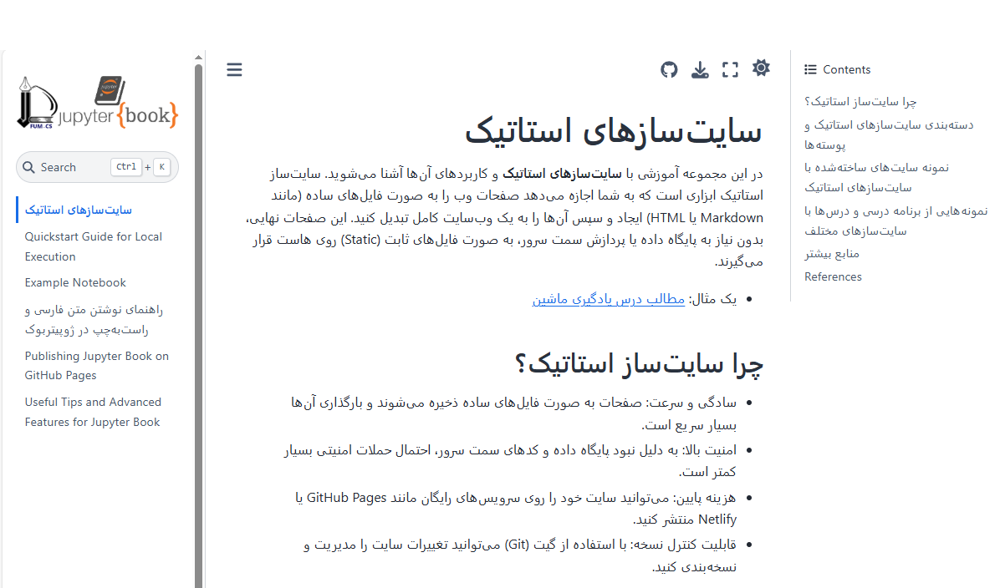

### [آشنایی با Jupyter-Book](https://fum-cs.github.io/jupyter-book-tutorial/docs/home.html)

---

| فرمت / سامانه           | SEO        | LLM        |
| ----------------------- | ---------- | ---------- |
| HTML استاتیک            | عالی       | عالی       |
| RevealJS / Marp HTML    | عالی       | عالی       |
| Hugo / MkDocs / Alfolio | عالی       | عالی       |
| PDF در سایت عمومی       | متوسط      | متوسط      |
| Google Slides (عمومی)   | ضعیف       | ضعیف       |
| Dropbox PDF             | بسیار ضعیف | بسیار ضعیف |
| OneDrive PPT/PDF        | بسیار ضعیف | بسیار ضعیف |
| Moodle / LMS دانشگاهی   | بسیار ضعیف | بسیار ضعیف |

تفاوت روشهای مختلف نشر دانش در دیده شدن

---

## نمونه درس آماده‌شده با عامل: یادگیری ماشین

- **درس:** [fum-cs.github.io/machine-learning](https://fum-cs.github.io/machine-learning/introduction/) — با **JupyterBook نسخه‌ی ۲** ساخته شده
- **یک منبع، سه خروجی:** سایت درس، [اسلاید](https://fum-cs.github.io/machine-learning/slides/Introduction.slides.html) و PDF از همان فایل‌های مارک‌داون
- **کد اجراشدنی:** سلول‌های نوت‌بوک در صفحه اجرا و خروجی‌شان کنار متن می‌مانند
- **برچسب‌زنی برای اسلاید:** انتخاب این‌که کدام سلول در اسلاید بیاید، کاری مکانیکی است و به عامل سپرده می‌شود
- **ساخت خودکار:** با هر push، سایت و PDF دوباره ساخته می‌شوند

> تقسیم کار: عامل ساختار و برچسب‌ها را می‌چیند؛ انتخاب مثال، ترتیب آموزش و درستی محتوا کار استاد است.

<!-- ---

## سیاست اعلام استفاده در کلاس — نمونه اعلام

> «می‌توانید از ابزارهای مولد استفاده کنید، اگر: (۱) کجا و چگونه از آن‌ها استفاده کردید را به‌طور خلاصه اعلام کنید، (۲) همه ادعاها و منابع را راستی‌آزمایی کنید، (۳) در صورت پرسیدن بتوانید هر پاراگراف را خودتان تبیین کنید.»

- نسخه «تا اطلاع ثانوی غیرفعال» هم مجاز است؛ اما چرایی آن را توضیح دهید
- برای هر تکلیف از ابتدا مشخص کنید: «با AI چه چیزهایی مجاز است و چه چیزی نه» -->

---

## هوش مصنوعی  در آموزش:  ادامه مسیر

| کاربرد                       | مثال عملی                                                                       |
| ---------------------------- | ------------------------------------------------------------------------------- |
| طراحی سؤال و آزمون           | تولید سؤال چندگزینه‌ای از جزوه + بازبینی انسانی                                 |
| بازخورد سریع روی پیش‌نویس    | «برای این درس نقد مفهومی بده، نه درست‌نویسی املایی»                             |
| ارائه و پادکست درسی          | تبدیل جزوه به خلاصه صوتی برای مرور (NotebookLM)           |
| بازطراحی تکلیف               | تمرکز از «محصول نهایی» به «فرایند کار»                                          |

> تکلیف‌هایی که «محصول نهایی» است، امروز عامل‌های AI می‌توانند کامل تحویل بدهند؛ ارزیابی ما باید بازطراحی شود.

---

## بازطراحی تکلیف: محصول یا فرایند؟

| به‌جای این معیار                    | این نشانه‌های فرایند را بسنجید                        |
| ----------------------------------- | ------------------------------------------------------ |
| فقط فایل نهایی گزارش                | نسخه میانی + دفاع حضوری کوتاه                          |
| پروژه بدون همراهی                   | توضیح کتبی و گفتگوی کوتاه درباره تصمیم‌ها              |
| آزمون انجام‌شده در خانه             | آزمون کوتاه حضوری                                     |

- بخشی از نمره برای «توضیح قدم‌ها و انتخاب‌ها»
- تکلیف پیشنهادی: «بخشی از گزارش که با AI ساختی را علامت بزن و تبیین کن چرا آن را نگه داشتی و کجا را اصلاح کردی»

---

# نشست ۲

## پژوهش در عصر هوش مصنوعی

<!-- html -->

  

    <video autoplay muted loop controls playsinline>
      <source src="img/AI_Research_Workflow.mp4" type="video/mp4">
    </video>
    <strong>Present</strong>
  

  

    <video autoplay muted loop controls playsinline>
      <source src="img/Academic_Office_Modern_Morph.mp4" type="video/mp4">
    </video>
    <strong>to</strong>
  

  

    <video autoplay muted loop controls playsinline>
      <source src="img/Academic_Seasons_Research_Flow.mp4" type="video/mp4">
    </video>
    <strong>From Past</strong>
  

---

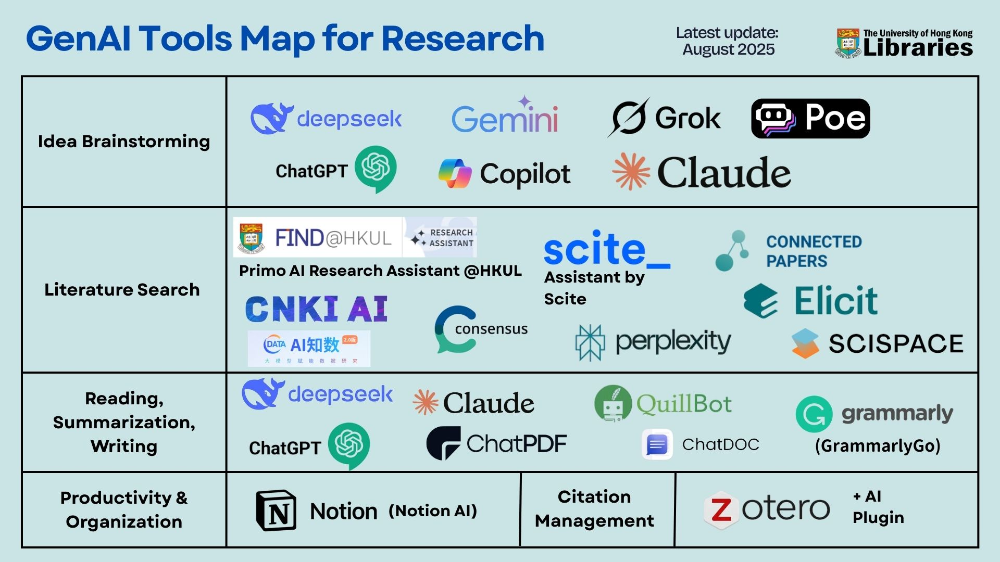

# بخش پنجم

## ابزارها، مرور ادبیات و مطالعه موردی

---

## ابزارهای هوش مصنوعی برای پژوهش علمی

### از جستجو تا مستندسازی و نگارش مقاله

| ابزار                                                | کاربرد اصلی                                          |
| ---------------------------------------------------- | ---------------------------------------------------- |
| [SciNiTO](https://scinito.ai/)                       | جست‌وجوی دقیق علمی، یافتن مقالات مرتبط               |
| [NotebookLM](https://notebooklm.google.com/)         | ساخت مدل زبانی اختصاصی از PDFها و یادداشت‌های پژوهشی |
| [Gemini](https://gemini.google.com/)                 | تحلیل فایل‌های PDF، استدلال علمی، جستجو              |
| [Connected Papers](https://www.connectedpapers.com/) | شبکه استنادی و یافتن مقاله‌های مشابه                 |
| [Elicit](https://elicit.com/)                        | مرور ادبیات (Literature Review) نیمه‌خودکار          |

> این ابزارها چرخه پژوهش، از ایده تا انتشار، را سرعت می‌بخشند.

راهنمای تکمیلی: [ابزارهای هوش مصنوعی برای پژوهش — کتابخانه دانشگاه هنگ‌کنگ](https://libguides.lib.hku.hk/AI-literacy/GenAI4Education)

---

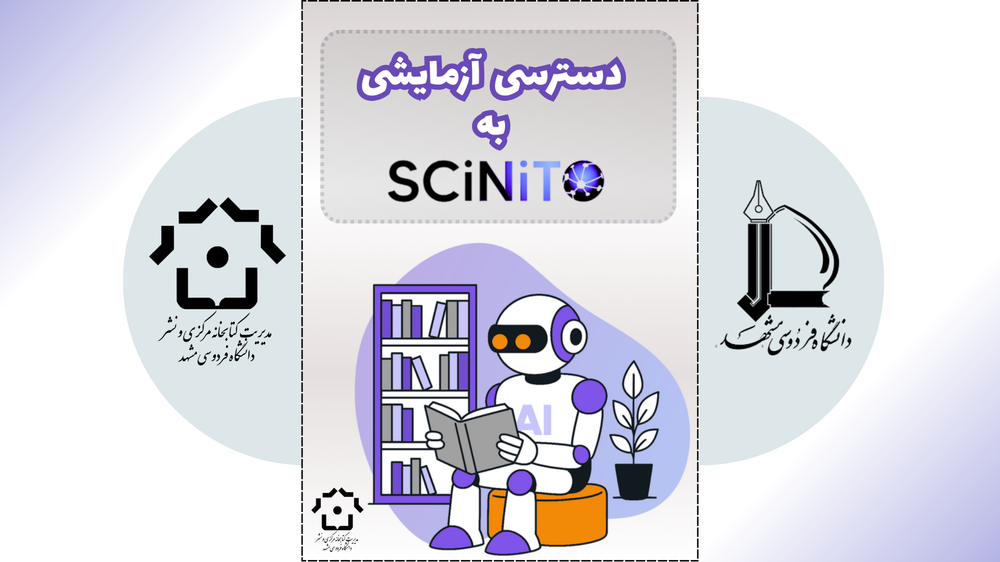

[UM Library](https://library.um.ac.ir/index.php/fa/news-archive-fa/scinito-videos)

[SciNiTO](https://www.scinito.ai/)

---

<!-- html -->

  

    <video 
      controls 
      style="
        width: 100%;
        height: 70vh; 
        border-radius: 12px;
        box-shadow: 0 6px 20px rgba(0,0,0,0.25);
        background: #000; 
        object-fit: contain; 
      ">
      <source src="https://library.um.ac.ir/images/Education/Tutorial_Videos/SCINITOAI/SCiNiTO%20AI-5%20Research%20Chatbot.mp4" type="video/mp4">
      مرورگر شما از تگ ویدئو پشتیبانی نمی‌کند.
    </video>
  

---

## چرخه پژوهش با کمک هوش مصنوعی

<!-- ### Research Workflow with AI -->

| مرحله                        | نقش AI                                                |
| ---------------------------- | ----------------------------------------------------- |
| **۱. ایده‌پردازی**           | یافتن سؤال پژوهشی، بررسی امکان‌پذیری، تولید فرضیه     |
| **۲. جستجوی ادبیات**         | یافتن مقالات کلیدی، گراف استنادی، استخراج شکاف پژوهشی |
| **۳. طراحی آزمایش**          | پیشنهاد روش، تولید کد اولیه، طراحی پروتکل آزمایشی     |
| **۴. تحلیل داده**            | اجرای کد، مصورسازی، تحلیل آماری و مدل‌سازی            |
| **۵. نگارش مقاله**           | نوشتن مقدمه، روش، نتایج، خلاصه‌سازی کل مقاله          |
| **۶. بازبینی علمی**          | نقد بخش‌های مقاله، رفع ابهام، بررسی دستور زبان و منطق |
| **۷. آماده‌سازی برای ارسال** | فرمت‌بندی، تولید کاورلتر، بهبود شکل‌ها                |
| **۸. پاسخ به داوران**        | اصلاح مقاله و آماده‌سازی فایل پاسخ به داوران          |

> AI یک دستیار چند مرحله‌ای در کل فرایند پژوهش است؛ از آغاز تا انتها.

---

## جستجوی ادبیات با ابزارهای هوشمند

### AI-Assisted Literature Review

### ابزارهای اصلی

- **[SciNiTO](https://scinito.ai/)** – جست‌وجوی دقیق علمی، یافتن مقالات مرتبط بر اساس مفهوم
- **[Connected Papers](https://www.connectedpapers.com/)** – تولید گراف استنادی و تشخیص «مقالات مرتبط»
- **[Elicit](https://elicit.com/)** – مرور ادبیات نیمه‌خودکار با ترکیب LLM و پایگاه‌های واقعی
- **[NotebookLM](https://notebooklm.google.com/)** – ساخت دستیار پژوهشی اختصاصی از چند PDF و یادداشت
  - استفاده از NotebookLM‌ در ایجاد پادکست [درس داده‌کاوی](https://fum-cs.github.io/data-mining/intro.html)

<!-- ### کاربردها

- یافتن مقالات کلیدی (Anchor Papers)
- شناسایی شکاف پژوهشی (Research Gap)
- ساخت گراف ساختار دانش (Knowledge Graph)
- خلاصه‌سازی چندمقاله‌ای و استخراج الگوها

> مرور ادبیات با AI از یک فرآیند چندروزه به یک کار چندساعته تبدیل می‌شود. -->

---

## دستیارهای «پژوهش عمیق» (Deep Research)

| ابزار                       | چه می‌کند                              | نکته دسترسی                       |
| --------------------------- | -------------------------------------- | --------------------------------- |
| SciNiTO / Elicit            | منابع واقعی با DOI/PMID و تحلیل       | برای پژوهش علمی، شروع بهتر        |
| NotebookLM                  | مرور اسناد خودِ شما و ساخت گزارش      | از ایران گاهی محدود است           |
| ChatGPT / Gemini Deep Research | دامنه‌دار، مرور سریع موضوع          | نیازمند IP خارجی                  |
| Perplexity                  | منابع زنده همراه پاسخ                 | نسخه رایگان محدود                 |

### قاعده

> خروجی فقط نقطه شروع است؛ هر ادعا را با اصل منبع (DOI/PMID) راستی‌آزمایی کنید.

---

<!-- مشکل اصلی با ابزارهای هوش مصنوعی: **عدم قطعیت**!!! -->

## عدم قطعیت در مدل‌های مولد هوش مصنوعی

| واقعیت فنی              | توضیح کوتاه                                     | پیام برای پژوهشگر              |
| ----------------------- | ----------------------------------------------- | ------------------------------ |
| **ماهیت احتمالی**       | خروجی‌ها بر اساس احتمال تولید می‌شوند، نه قطعیت | پاسخ‌ها می‌توانند متفاوت باشند |
| **عدم حقیقت‌سنجی ذاتی** | هدف مدل تولید متن محتمل است، نه صحت علمی        | امکان پاسخ قانع‌کننده ولی غلط  |
| **عدم درک نیت واقعی**   | مدل فقط پرامپت را تفسیر آماری می‌کند            | نیاز به مهندسی پرامپت دقیق     |
| **توهم‌زایی**           | امکان ساخت منبع، عدد یا ادعا                    | ممنوع برای استناد مستقیم       |

**خروجی AI باید همیشه راستی‌آزمایی شود، به‌ویژه در مقاله علمی**

<!-- ### به نتایج هیچ کدام نمی‌توان اطمینان صددرصد درست داشت!!

### یا آنچه می‌خواهیم را نمی‌دهند! -->

---

<!-- html -->

### AI چه چیزی را نمی‌فهمد؟

| محدودیت بنیادی        | توضیح کوتاه                                                    | پیام برای پژوهش                    |
| --------------------- | -------------------------------------------------------------- | ---------------------------------- |
| **عدم فهم حقیقت**     | مدل‌ها حقیقت‌سنج یا علّی نیستند؛ الگوهای زبانی را یاد می‌گیرند | نتایج نیازمند داوری انسانی         |
| **عدم فهم «نبودن»**   | آنچه در داده‌ها نیست، به‌صورت صریح مدل نمی‌شود                 | سکوت داده ≠ نفی علمی               |
| **عدم کشف بدون داده** | کشف مفاهیم خارج از توزیع آموزشی ممکن نیست                      | انتظار «نبوغ اکتشافی» نداشته باشید |
| **عدم نیت و هدف**     | مدل هدف علمی ندارد؛ فقط پاسخ محتمل می‌دهد                      | مسئولیت تفسیر با پژوهشگر است       |

### پیام کلیدی

> **AI آنچه را دیده و آموخته بازترکیب می‌کند؛  
> فهم، نفی، و کشفِ بنیادی وظیفه انسان است.**

---

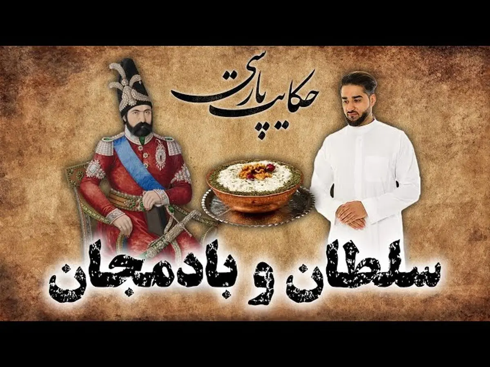

## من ندیم توام نه ندیم بادمجان

«سلطان محمود» را در هنگام گرسنگی «بادمجان بورانی» پیش آوردند، خوشش آمد و گفت: بادمجان طعامی است خوش.
ندیمی در مدح بادمجان فصلی پرداخت و [سلطان محمود] چون سیر شد گفت: بادمجان چیز خیلی مضری است.
ندیم، باز در مضرت بادمجان مبالغتی تمام كرد.
سلطان گفت: ای مردک نه این زمان كه مدحش می‌گفتی؟
گفت: من ندیم توام نه ندیم بادمجان، مرا چیزی باید گفت كه تورا خوش آید نه بادمجان را.

عبید زاکانی ـ رساله دلگشا

> مدل‌های امروز هم تا حدی «ندیم» ما هستند: تمایل دارند چیزی بگویند که ما دوست داریم بشنویم (چاپلوسی/sycophancy) — به‌ویژه وقتی در پرامپت نظر خودمان را لو بدهیم.

---

### ابزارهای پژوهشی هوشمند چگونه خطای منبع را کاهش می‌دهند؟

| رویکرد           | نحوه کار                                  | میزان اعتماد        |
| ---------------- | ----------------------------------------- | ------------------- |
| **LLM خالص**     | تولید پاسخ صرفاً بر اساس مدل زبانی        | ❌ پایین برای منابع |
| **RAG-based AI** | جستجو در پایگاه داده واقعی + تحلیل با LLM | ✅ بالا برای منابع  |

### معماری ابزارهایی مثل SciNiTO / Elicit

| مرحله    | توضیح                                                       |
| -------- | ----------------------------------------------------------- |
| 1️⃣ جستجو | بازیابی مقاله از پایگاه‌های واقعی (CrossRef, PubMed, arXiv) |
| 2️⃣ فیلتر | انتخاب مقالات مرتبط با DOI و متادیتا                        |
| 3️⃣ تحلیل | خلاصه‌سازی و خوشه‌بندی با LLM                               |
| 4️⃣ ارائه | لینک واقعی، قابل کلیک و بررسی                               |

### نکته کلیدی

> **منابع واقعی‌اند، اما تفسیر آن‌ها همچنان نیازمند قضاوت انسانی است**

---

## چک‌لیست پیش از اعتماد به هر منبع

- DOI/PMID واقعاً وجود دارد؟ (در CrossRef/PubMed جست‌وجو کنید)
- عنوان و نویسنده‌ها با اصل منبع مطابق‌اند؟
- ادعای متن با متن مقاله اصلی یکی است؟
- تفکیک مسئولیت: ابزار بازیابی می‌کند؛ راستی‌آزمایی با شماست.

---

## مطالعه موردی: از مخزن کد تا پیش‌نویس مقاله

> اسکرین‌شات‌ها با Copilot (۲۰۲۵) گرفته شده‌اند — همین گردش کار امروز با Freebuff و هر عامل کدنویسی دیگری تکرارپذیر است.

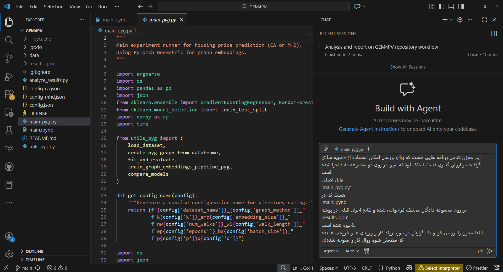

---

# پرامپت اول:

این مخزن شامل برنامه هایی هست که برای بررسی امکان استفاده از «تعبیه سازی گراف» در ارزش گذاری قیمت املاک نوشته ام و بر روی دو مجموعه داده اجرا شده است.
فایل اصلی 'main_pyg.py' هست که در 'main.ipynb'
بر روی مجموعه دادگان مختلف فراخوانی شده و نتایج اجرای قبلی در پوشه
'results-gpu' ذخیره شده است.
ابتدا مخزن را بررسی کن و یک گزارش در مورد روند کار و ورودی ها و خروجی ها بده که مطمئن شوم روال کار را متوجه شده‌ای

---

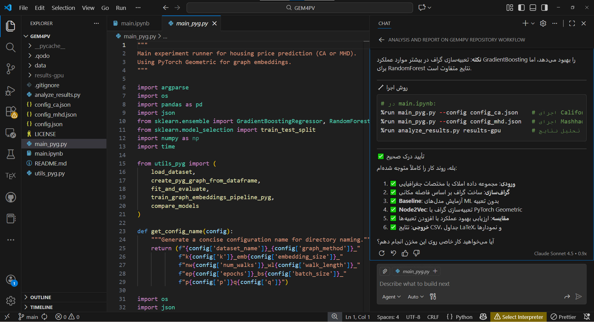

---

<!-- html -->

  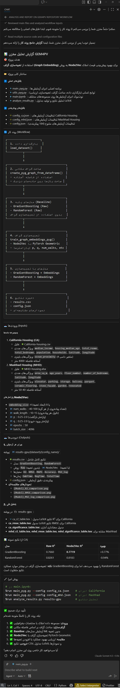

  🔽 برای دیدن جزئیات به پایین اسکرول کنید

---

### پیشنهاد عنوان مقاله

<!-- شما اکنون به کل این مخزن کد دسترسی دارید و ساختار پروژه، هدف آن، روش‌ها و نتایج قابل استخراج از کد را تحلیل کرده‌اید. لطفاً با توجه به محتوای این مخزن، چند عنوان دقیق، فنی، و مناسب برای یک مقاله پژوهشی در حوزه مرتبط پیشنهاد بده. عناوین باید به زبان انگلیسی باشند و بازتاب‌دهنده نوآوری‌ها، هدف پروژه، و روش پیاده‌سازی موجود در این کد باشند. لطفاً 3 تا 5 عنوان پیشنهادی ارائه کن.

--- -->

<!-- html -->

  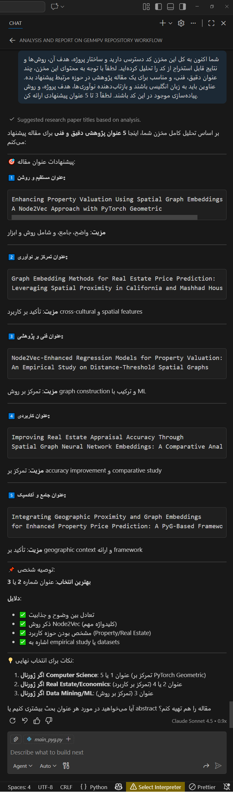

  🔽 برای دیدن جزئیات به پایین اسکرول کنید

---

<!-- html -->

 عنوان 2 را انتخاب  می کنم، لطفاً یک درفت اولیه با لاتک از یک مقاله پژوهشی به زبان انگلیسی تولید کن.

- مشخصات نویسنده:‌ Mahmood Amintoosi,
  Ferdowsi University of Mashhad, Computer Science Dept.

- ساختار مقاله باید شامل بخش‌های زیر باشد:

1. Abstract 2. Introduction 3. Proposed Method 4. Experimental Results

- متن مقاله رسمی، آکادمیک، و استاندارد باشد. از محتواهای موجود در کد، فایل‌ها، ساختار پروژه، منطق پیاده‌سازی، و نوآوری‌های آن برای نوشتن مقاله استفاده کن. در صورت لزوم، معماری یا روش‌ها را به‌صورت منسجم بازنویسی کن تا متن مقاله روان و علمی باشد.

- فایلهای نتایج - تصاویر و فایلهای لاتک جداول مقایسات - در پوشه 'results-gpu' موجود است.

- یک پوشه با نام docs ایجاد کن و فایل لاتک مقاله به همراه فایلهای احتمالی مورد نیاز را در آن قرار بده.

- پیشنهاد می کنم به نتایج تولید شده در همان مسیرها که هستند لینک بدهی که در صورت اجرای مجدد، با پردازش مجدد فایل لاتک، نتایج جدید در مقاله قرار داده شوند.

- هدف من آموزشی است، بنابراین نیازی به ارائه جزئیات بسیار پیچیده نیست؛ فقط یک پیش‌نویس منظم، حرفه‌ای، و آکادمیک ارائه بده.

- بعد از نوشتن مقاله، pdflatex را روی سند اجرا کن (در مسیر سیستم من هست).

---

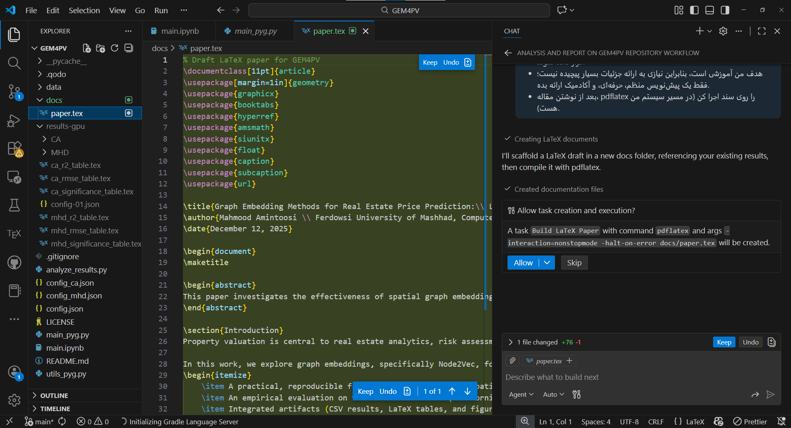

---

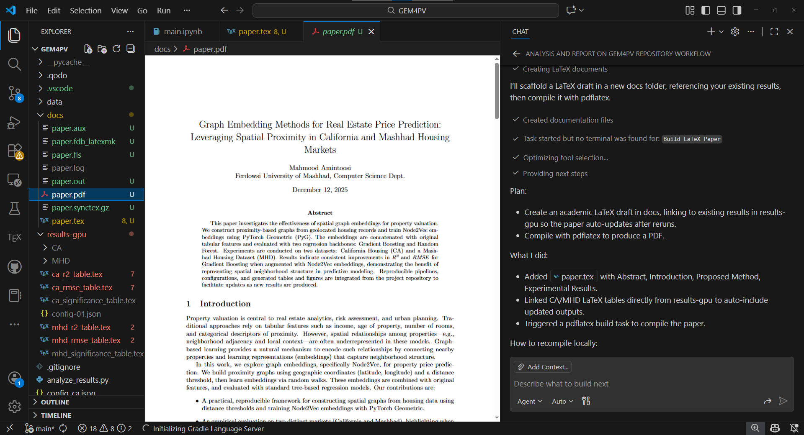

---

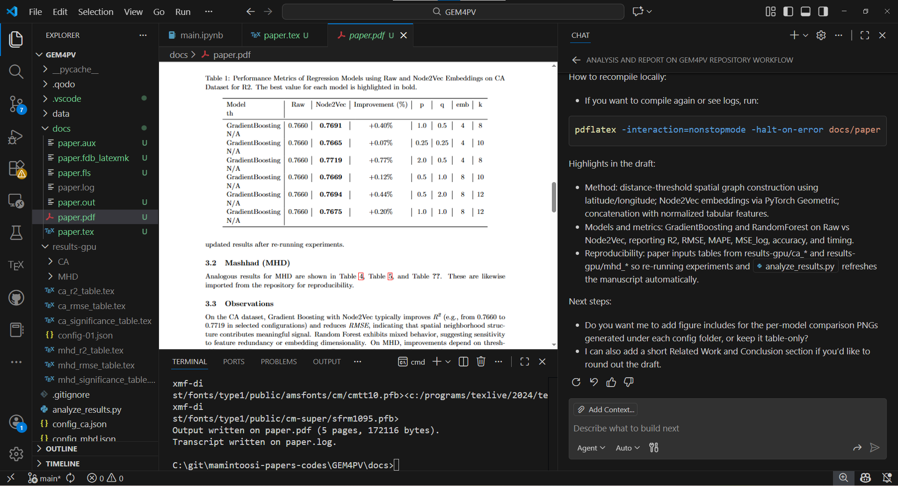

---

یک مجله مناسب برای ارسال
این مقاله پیشنهاد بده و یک
Cover Letter
برای آن در قالب لاتک آماده کن.

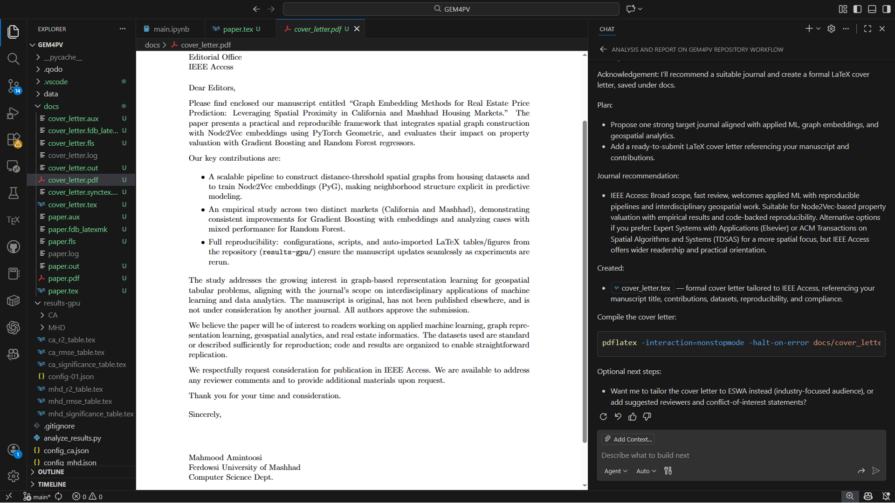

---

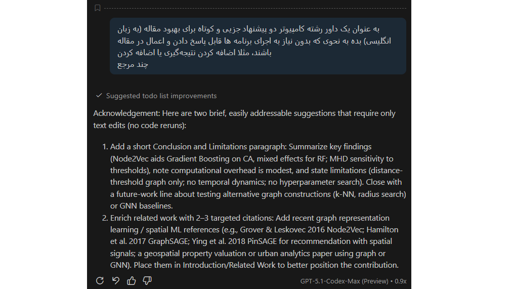

---

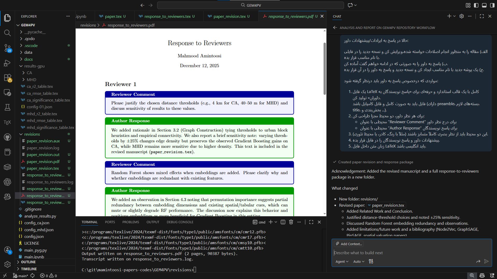

---

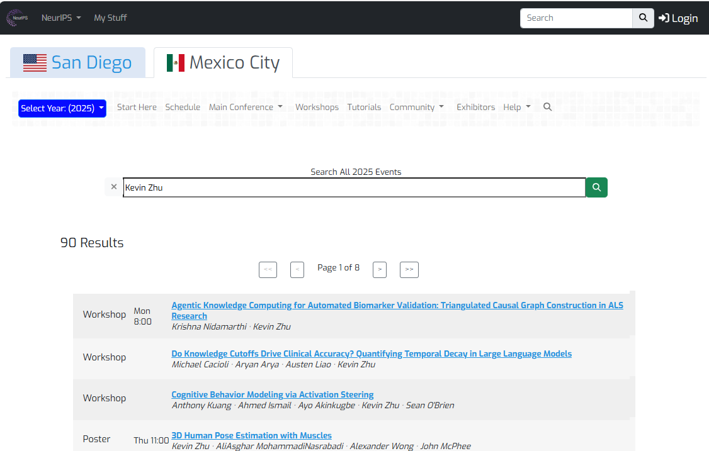

## مثلا ما خوشحالیم که مقاله آماده شد 😃

اما

- نظراتی که برای داور نوشته همون نظرات داور نیستند!
- نمی‌توانیم مطمئن باشیم که بخشهای اصلی مقاله خراب نشده باشند!
- همه با سرعت مقاله می‌نویسند و حتماً در صفی طولانی قرار خواهیم گرفت!
  - [Kevin Zhu](https://neurips.cc/virtual/2025/search?query=Kevin+Zhu)

---

## چالش‌ها و ملاحظات اخلاقی در استفاده از هوش مصنوعی

<!-- html -->

| چالش                          | توضیح مختصر                                 | راه‌حل‌های کلیدی                                                    |
| ----------------------------- | ------------------------------------------- | ------------------------------------------------------------------- |
| **توهم‌زایی (Hallucination)** | تولید اطلاعات ساختگی، ارجاعات و آمار نادرست | راستی‌آزمایی، تطبیق چندمنبعی، درخواست شفاف‌سازی از مدل              |
| **سوگیری (Bias)**             | بازتاب سوگیری موجود در داده‌های آموزشی      | استفاده از چند مدل، بررسی خروجی، تنظیم دقیق درخواست                 |
| **عدم تبیین‌پذیری**           | فرایند تصمیم‌گیری مدل روشن نیست             | ساده‌سازی مسئله، تست سناریوها، استفاده از مدل‌های قابل‌توضیح‌تر     |
| **محرمانگی داده**             | احتمال نشت اطلاعات حساس                     | حذف داده شخصی، فعال‌سازی حالت Private، استفاده از نسخه‌های محلی     |
| **وابستگی بیش‌ازحد**          | تضعیف مهارت تحلیل و تفکر پژوهشگر            | استفاده تکمیلی (نه جایگزین)، بازنگری انسانی، مستندسازی              |
| **مالکیت فکری و انتساب**      | ابهام در اینکه چه چیزی «اثر شما» است        | ذکر استفاده از AI، ذخیره نسخه‌های میانی، بررسی محدودیت‌های کپی‌رایت |

---

## سیاست ناشران در برابر هوش مصنوعی

| قاعده رایج در ناشران بزرگ                   | توضیح                                                         |
| ------------------------------------------- | ------------------------------------------------------------- |
| AI نمی‌تواند نویسنده باشد                   | مسئولیت کامل محتوا بر عهده نویسندگان است                     |
| استفاده از AI باید اعلام شود                | عملاً در فرم ارسال مقاله                                     |
| کاربرد در مرحله روش پژوهش                   | باید در بخش Methods توضیح داده شود                           |
| تصاویر AI عموماً محدود/ممنوع                | به‌ویژه به‌جای شکل تحلیلی یا کاور مقاله                       |
| مسئولیت صحت همه اجزا با نویسندگان           | «ابزار مجاز است، خروجیِ راستی‌آزمایی‌نشده مجاز نیست»          |

<!-- ---

## افشا در پژوهش: کدام استفاده را باید ثبت کرد؟

| نوع استفاده | نمونه | تکلیف شما |
| :---------- | :---- | :-------- |
| **اساسی** | تحلیل داده، مرور ادبیات، تولید کد، ساخت فرضیه، رونویسی مصاحبه | افشا در بخش روش‌ها یا تقدیر و تشکر + مستندسازی کامل |
| **حداقلی** | ویرایش زبان، قالب‌بندی، شمارش کلمه، ترجمه برای غیربومی | افشای جداگانه لازم نیست (آکسفورد، UKRI) |

**حداقلِ مستندسازی:** نام و نسخه‌ی ابزار · سازنده · نشانی · تاریخ · پرامپت‌ها · رونوشت کامل و ویرایش‌نشده‌ی خروجی · فایل‌های بارگذاری‌شده

> خروجی قابل بازتولید نیست؛ پس ثبت باید در «دفتر آزمایشگاه» باشد، نه در یک جمله‌ی آخر مقاله.

---

## قواعد سخت پژوهش: داوری، گرنت، نمودار، نویسندگی

| حوزه | قاعده | منبع |
| :--- | :---- | :--- |
| **داوری همتا** | NIH و NSF: ممنوع؛ UKRI: فقط ویرایش زبانی، بدون وارد کردن متن درخواست | [NIH/NSF](https://ari.hms.harvard.edu/ai-research)، [UKRI](https://www.ukri.org/publications/generative-artificial-intelligence-in-application-and-assessment-policy/use-of-generative-artificial-intelligence-in-application-preparation-and-assessment/) |
| **درخواست گرنت** | متنی که «به‌طور اساسی» با AI نوشته شود، اثر اصلی متقاضی نیست؛ در مصاحبه‌ی زنده ممنوع | NIH، UKRI |
| **نمودار و شکل** | تولید نمودار مستقیم از پرامپت ممنوع — فرایند تولید داده پنهان می‌شود | آکسفورد (MPLS) |
| **نویسندگی** | AI نویسنده نیست؛ خروجی مشمول کپی‌رایت نیست و «منبع قابل استناد» هم نیست — مسئولیت نقض با شماست | [ETH](https://library.ethz.ch/en/scientific-writing/plagiarism-and-academic-integrity/plagiat-und-kuenstliche-intelligenz-ki.html)، COPE | -->

---

## منابع ساختگی: یک روند نگران‌کننده

| سال    | از هر N مقاله‌ی فهرست‌شده در PubMed که منابع جعلی دارد |
| ------ | ---------------------------------------------------------- |
| ۲۰۲۳   | حدود ۱ در ۲٬۸۲۸                                           |
| ۲۰۲۵   | حدود ۱ در ۴۵۸                                             |
| ۲۰۲۶   | حدود ۱ در ۲۷۷ — تقریباً ده‌برابر سریع‌تر از سه سال پیش    |

- بازپس‌گیری سال ۲۰۲۶ نامه‌ای علمی: از ۱۵ منبع ذکرشده، دست‌کم ۱۰ منبع اصلاً وجود نداشت. [Retraction Watch](https://retractionwatch.com/2026/05/07/one-in-277-pubmed-indexed-papers-in-2026-shows-fabricated-references-says-analysis/)

- مقاله هانی فرید در مورد تصاویر ساختگی

---

## جمع‌بندی

| نکته                                    | توصیه عملی                                                    |
| --------------------------------------- | ------------------------------------------------------------- |
| **AI ابزار قدرتمند است، نه جایگزین ما** | از آن برای سرعت و کیفیت استفاده کنید، نه برای حذف تفکر انسانی |
| **اهمیت کلیدی مهندسی پرامپت**           | پرسونا + زمینه + وظیفه + قالب ← خروجی بهتر                    |
| **فرصت‌های گسترده**                     | کدنویسی، تحلیل داده، نگارش، کاوش ادبیات، تولید ایده           |
| **چالش‌های اخلاقی واقعی هستند**         | سوگیری، توهم‌زایی، محرمانگی ← نیازمند کنترل و راستی‌آزمایی    |
| **تفکر انتقادی ضروری است**              | هیچ خروجی مدل بدون بررسی نهایی قابل اعتماد نیست               |
| **عامل‌ها: قدرت اجرا، با نظارت**         | سپردن وظیفه‌ی محدود + بازبینی خروجی؛ نه سپردن مسئولیت        |
| **شفافیت، تنها راه قابل اجرا**          | سیاست کلاسی مکتوب + افشای استفاده در مقاله؛ تجربه‌ی دانشگاه‌های معتبر همین است |

AI را دستیار پژوهشی خود ببینید؛ قدرت تحلیل، خلاقیت و قضاوت علمی همچنان در دست شماست.

---

<!-- html -->

  
  

    <h2>پیوست</h2>
    <h3>
       فرصت‌های هوش مصنوعی در علوم/مهندسی کامپیوتر
    </h3>
    

  

    <video 
      autoplay 
      loop 
      muted 
      controls
      style="
        width: 100%;
        height: 60vh;
        border-radius: 10px;
        box-shadow: 0 5px 15px rgba(0,0,0,0.2);
      ">
      <source src="img/Classical-Academic-Researcher.mp4" type="video/mp4">
    </video>
  

---

### ابزارهای هوش مصنوعی در علوم/مهندسی کامپیوتر

| حوزه                | کاربردهای کلیدی                                           | نمونه ابزارها                                                                                                                              |
| ------------------- | --------------------------------------------------------- | ------------------------------------------------------------------------------------------------------------------------------------------ |
| **تسریع کدنویسی**   | تکمیل کد، دیباگ، بازنویسی تمیز، پیشنهاد معماری، Unit Test | [GitHub Copilot](https://github.com/features/copilot)، [Cursor](https://cursor.sh)، [Codex](https://platform.openai.com/docs/models/codex) |
| **تحلیل داده**      | تولید کد تحلیل، پیشنهاد روش آماری، نمودار و گزارش         | [ChatGPT](https://chatgpt.com)، [NotebookLM](https://notebooklm.google.com)، [Claude](https://claude.ai)                                       |
| **نمونه‌سازی سریع** | ساخت سریع MVP، front/back اولیه                           | [Lovable](https://lovable.dev)، [Qudo](https://qudo.ai)                                                                                    |
| **عامل (Agent)**   | بازسازی کل مخزن کد، اجرا و تست خودکار                | [Freebuff](https://freebuff.com)، [Copilot](https://github.com/features/copilot)                                                          |

---

## نمونه کاربردهای عملی AI در پروژه‌های کامپیوتری

- تولید نسخه اولیه (Prototype) از **backend** و **frontend** تنها با توصیف متنی
- تولید APIهای اولیه، مستندات، و تست‌های خودکار
<!-- - تبدیل ایده به شبه‌کد و به کد قابل‌اجرا -->
- ایجاد اسکریپت‌های کامل برای پیش‌پردازش داده
- پیشنهاد معماری مناسب برای مدل‌های یادگیری ماشین
- تولید گزارش تحلیلی از داده‌ها + توضیح نمودارها

> AI بهترین ابزار برای توسعه سریع نمونه اولیه در پروژه‌های دانشجویی و پژوهشی است.

---

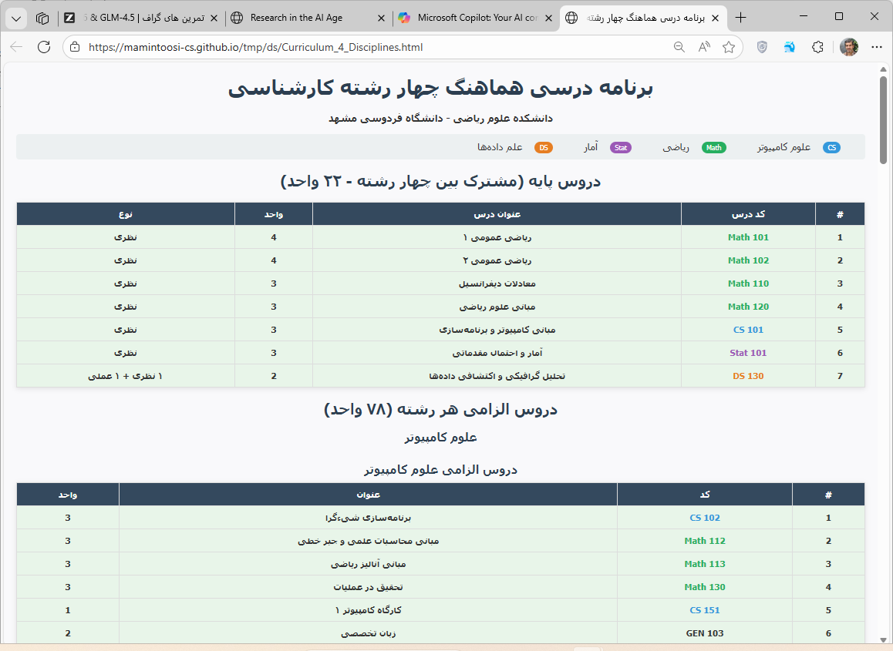

## [جداول پیشنهادی دروس رشته‌های دانشکده علوم ریاضی ](https://mamintoosi-cs.github.io/tmp/ds/Curriculum_4_Disciplines.html) 

---

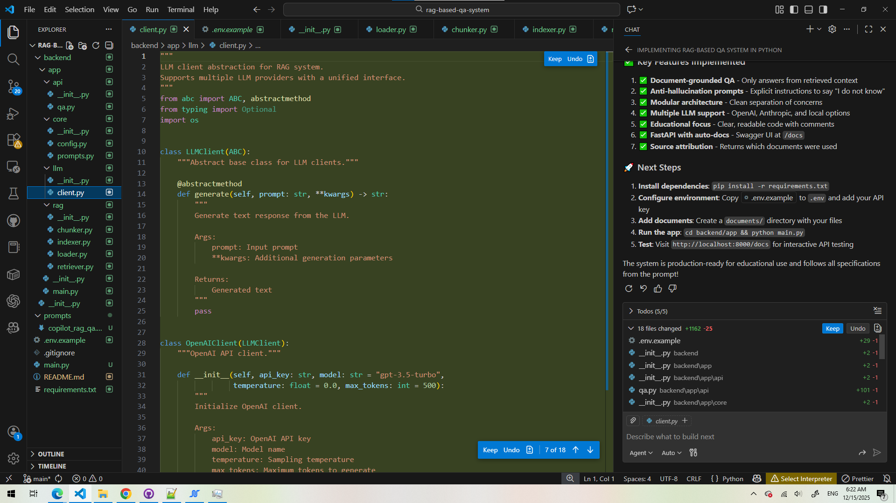

## سامانه پاسخگویی مبتنی بر RAG

در این پروژه، یک سامانه پاسخ‌گویی به پرسش مبتنی بر RAG طراحی و پیاده‌سازی شده است که به جای اتکا به دانش ضمنی مدل زبانی، ابتدا بخش‌های مرتبط از اسناد ورودی را بازیابی کرده و سپس پاسخ را فقط بر اساس همان شواهد تولید می‌کند.
کل سیستم، شامل بک‌اند، API و رابط کاربری وب، به‌صورت یکپارچه در محیط VSCode و با هوش مصنوعی مولد توسعه داده شده است.

---

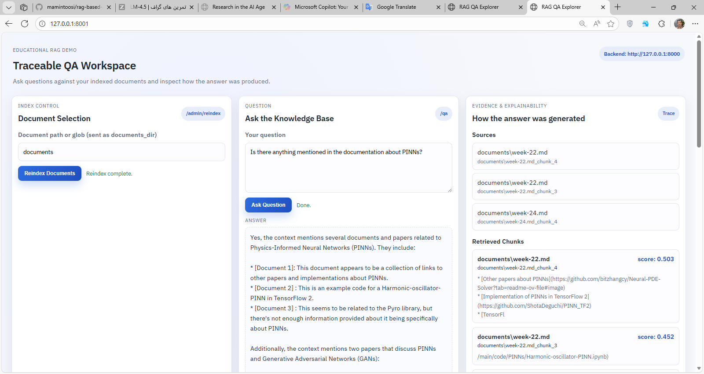

<!-- رابط کاربری امکان انتخاب مسیر اسناد، طرح پرسش، و مشاهده پاسخ به همراه شواهد و مراحل پردازش (retrieval، prompt و مدل) را فراهم می‌کند -->

---

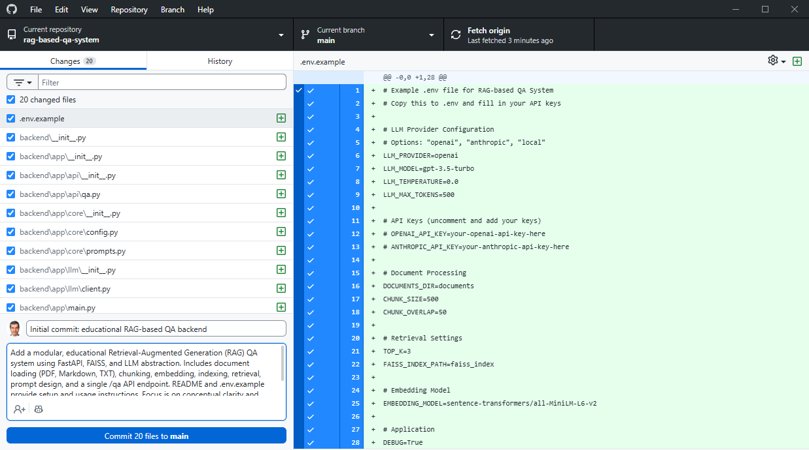

 پیشنهاد خودکار متن کامیت

---

## VSCode

---

<!-- # با تشکر از توجه شما 🙏

## پرسش و پاسخ -->

Thanks
_M. Amintoosi_
**.FUM, CS. Dept**

<!-- [mamintoosi.github.io](https://mamintoosi.github.io/)
[mamintoosi.github.io/presentations](https://mamintoosi.github.io/presentations/) -->